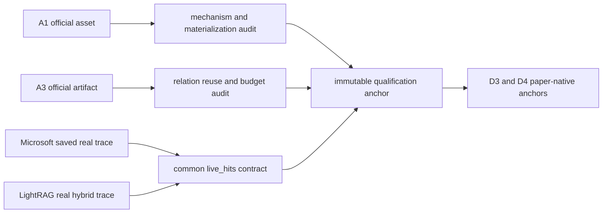

# WP2 A1/A3 机制预算与后端 Trace 资格报告

_2026-09-10；comparison-v1.2；本地资产、语料物化与真实 trace 合同审计，不是攻击或防御效果实验。_

---

## 🧾 Material passport

| 字段 | 内容 |
| --- | --- |
| Origin skill | academic-research-suite / experiment-agent；markdown-mermaid-writing |
| 事实源 | `F:\LogicGuard_project\logicguard` |
| 配置 | `comparison_v1_2_a1_a3_trace_qualification.yaml`、`comparison_v1_2_a1_a3_common_dev_materialization_anchor.yaml`、`comparison_v1_2_lightrag_real_trace_anchor.yaml`、`comparison_v1_2_real_trace_contract_anchor.yaml` |
| 入口 | `wp2_qualification_runner`、`attack_corpus_materializer`、`lightrag_trace_capture`、`real_trace_contract_runner` |
| 产物 | `artifacts/benchmark/research_revision_v1_2/wp2/` 下四个独立不可变 anchor namespace |
| 证据级别 | 机制、预算解释与 adapter 工程资格；非 ASR/EM/F1 |
| Provider 调用 / 新增费用 | 2 / ¥0.001644 |

## 🎯 任务目的与判定边界

本任务回答三个进入 dev60 前的工程问题：A1 官方资产是否具备可复算的文档级攻击单元；A3 官方 artifact 的共享关系选择与污染数量究竟如何计算；两套后端的 native retrieval evidence 能否转成 T0/T1/D6 共用的 source-group 输入。通过不等于攻击有效，更不等于 LogicGuard 有效。

## 📊 验收结果

| 对象 | 结果 | 当前允许结论 |
| --- | --- | --- |
| A1 PoisonedRAG | 100 records、每条 5 texts，共 500；22–34 words，均值 27.694 | 官方固定资产结构和 question-prefix 物化语义可审计 |
| A1 target surface | 460/500 文本含错误目标字面，40/500 不含 | 仅为诊断；不得以字面缺失否定机制，也不得当作 ASR |
| A3 GRAGPoison | 74 rows；raw direct/indirect/enhanced = 750/370/435 | 官方 artifact 字段、节点关系和三类文本可审计 |
| A3 上游选择 | selected occurrences = 654/370/437，总计 1,461；unique total = 1,341 | poison budget 必须区分 raw、occurrence、unique 与 3 个物理输入文件 |
| A3 caveat | 16 次相邻关系复用；1 个非相邻重复键未合并；90 个索引重叠出现 | 上游实现不是全局关系去重；重复不能隐去 |
| A3 word budget | selected max = 72 words < 400 | 只通过 post-hoc audit；上游没有在生成阶段硬执行 400-word 门 |
| Microsoft GraphRAG | 历史 clean trace 50 query、1,870 sources，1,870/1,870 正文 exact-match | 真实 saved-trace adapter 与 doc/source-group recovery 可用；不是新实验 |
| LightRAG | schema fixture 通过；随后真实 hybrid query_data 返回 6 chunks | 单查询真实 trace adapter 可用；不能外推到 dev60 或污染语料 |

## 🔍 学术解释

A1 的论文原生资产锚点已经补上，但共同基准中的 question-only 生成仍是明确的 inspired adaptation。A3 的论文 artifact 证明了共享关系攻击的可物化路径，也揭示其预算不能用单一数字表示：上游只比较相邻 query 的关系键，且 `calculate_need_to_keep` 在不能整除时会产生重叠索引。因此，正式表格必须同时报告攻击文本出现次数和唯一文本数，并把共享关系作为聚类单元。

Microsoft 结果只证明已有真实 trace 可进入统一证据合同；它来自历史 clean run，不能替代新 dev60、attacked trace 或 T0/T1 执行。LightRAG 当前甚至没有真实 retrieval trace，故双后端资格仍未完成。

## 🚧 尚未解锁的结论

- 不能报告 A1/A3 在任何后端上的 ASR、检索暴露率或 Prompt 暴露率。
- 不能报告 T0/T1 或 LogicGuard 的 clean utility、防御率、错误恢复率。
- 不能把 500 个 A1 文本与 1,461 个 A3 出现次数直接视为同等攻击强度。
- 不能把 Microsoft 历史 clean trace 或 LightRAG fixture 写成三数据集双后端实验。

## ✅ 2026-09-10 后续执行结果

| 对象 | 实际结果 | 解释边界 |
| --- | --- | --- |
| A1 materializer | 1 query、1 occurrence/unique、40 words、占 clean corpus 0.0102% | 现有 pilot 锚点；非 paper-native 5-doc，非完整 dev60 |
| A3 materializer | 1 query、8 occurrences、6 unique、direct/enhanced/indirect 三个物理文件、占 clean corpus 0.0686% | 重现上游小列表索引重叠；非 paper-native Nα/Nβ，未证明跨 query 共享收益 |
| LightRAG real trace | hybrid、6 chunks、1 LLM + 1 embedding；666/37 chat tokens、33 embedding tokens | 真实 clean 十文档索引副本；无回答生成、无攻击 |
| 双后端合同 | Microsoft 42 sources + LightRAG 6 chunks；48/48 clean exact-match；4 contexts/2 audits/0 failures | 只运行 0% coverage schema admission；未运行真实 trusted-pool retrieval |
| 成本与完整性 | ¥0.001644；thinking/retry=0；历史 LightRAG 索引 hash 未变化 | 低于 ¥0.04 hard cap；没有重新索引 |

物化器输出冻结 input/config/implementation/corpus hash，并同时记录 occurrence、unique、physical file、word、comparison token 和相对 clean-corpus 比例。A1 严格使用上游 `question + "." + adversarial_text` 拼接；A3 明示 relation key 是 bounded port 的 `root_nodes + modified_middle_node + target_relation` 适配，不能改称论文原生语料。

## ➡️ 下一项任务与退出门

物化器、LightRAG real trace 和双后端 0%-coverage contract 的锚点门已经通过。后续 D3 固定权重/发布工件锚点已通过；D4 官方工件因源码和提示词缺陷 fail-closed，详见 [D3/D4 资格报告](D3_D4_ExternalDefense_WP2_Qualification.md)。下一项是冻结并运行完整 dev60 A1/A2/A3 生成与物化。100/50/20% trusted-pool 仍需在两个后端真实检索，不能用本次 exact clean mapping 代替。
