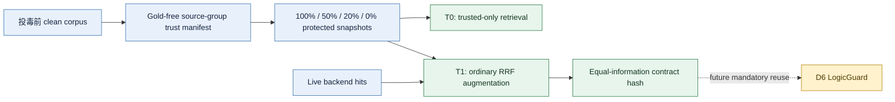

# WP2 T0/T1 共享可信证据与等预算控制本地验收

_版本：comparison-v1.2；日期：2026-09-08；证据级别：离线工程验收，不是防御效果实验。_

---

## 🪪 Material passport

| 字段 | 内容 |
| --- | --- |
| Origin skill | `academic-research-suite / experiment-agent`、`markdown-mermaid-writing` |
| Fact source | `F:\LogicGuard_project\logicguard` |
| 实现入口 | `logicguard.benchmark.trusted_control_runner` |
| 配置 | `configs/benchmark/comparison_v1_2_trusted_controls_fixture.yaml` |
| 产物 | `artifacts/benchmark/research_revision_v1_2/wp2/trusted_controls_synthetic_anchor_final/` |
| 运行性质 | 2 个合成问题、2 个规范化后端标识、4 个可信覆盖档；不连接真实后端，不调用 provider |
| 允许结论 | trust assignment、预算、融合、泄漏拒绝与三态语义的工程合同可执行 |
| 禁止结论 | T0/T1 或 LogicGuard 能降低 ASR；Microsoft GraphRAG/LightRAG 的真实结果已获得 |

## 🎯 本项工作解决的问题

旧 Stage25/28 可以访问完整 clean reference，并把“没有匹配到 clean candidate”编码成 `is_risky=false`。这会同时造成信息优势和语义错误：完整干净库不是现实中的部分可信根；无法验证也不能解释为安全。v1.2 因而要求在投毒前、不读取 gold/support 或攻击结果的条件下，先固定 source-group 级 protected snapshot，并给普通对照和未来 D6 同样的候选访问与资源上限。

本实现把实验信息流固定为：

## 🧱 已实现的合同

1. `trust_manifest.py` 对输入 clean corpus 使用严格 allowlist，并递归拒绝 `gold`、`answer`、`support`、攻击/防御结果和 changed-document 等 evaluator 字段。
2. 可信覆盖在 `source_group_id` 层面以 dataset revision、冻结 seed 和 group ID 的 hash 排序形成嵌套前缀。合成锚点 5 个来源组对应 100/50/20/0% 的 5/2/1/0 组；同源 chunk 不会被拆开分配。
3. 每个覆盖档从投毒前 clean corpus 物化独立 protected snapshot，并保存 manifest、group/document hash 和运行身份。
4. `RetrievalBudget` 同时冻结 live/trusted top-k、最终来源数、上下文 token、检索调用、模型调用和 RRF 常数。T0/T1 行都保存同一个 budget hash；T0 只使用 trusted pool，T1 对 live 与 trusted 使用普通 RRF，不执行 LogicGuard 判别。
5. T1 同一来源组同时出现 live 与 trusted copy 时使用 protected clean copy，但仍记录两个 contributing pools。未来 D6 必须逐 case 复用 T1 的 manifest、budget、candidate pool 和 equal-information contract hash。
6. Stage28 `SourceRiskResult` 新增 `verified_safe / verified_risky / unverifiable`；candidate 缺失记录为 `unverifiable + trusted_candidate_unavailable`，不再从语义上伪装成已验证安全。旧布尔字段暂时保留以维持历史路径兼容。

## ✅ 离线验收结果

| 验收项 | 结果 |
| --- | ---: |
| 合成 query-backend 对 | 4 |
| 覆盖档 | 4 |
| T0/T1 context rows | 32 |
| 等预算与来源边界 audit rows | 16 |
| Audit failures | 0 |
| Provider calls | 0 |
| 新增费用 | ¥0 |

0% 覆盖下，T0 的 4/4 行均为 `UNVERIFIABLE`，而 T1 仍可使用 live hits；这证明缺少可信候选被显式保留下来。20% 和 50% 覆盖下，T0 各有 2/4 行不可验证，100% 覆盖下为 0/4。这里的比例只反映特意构造的合成夹具，不是实际数据集可回答率。

验收还覆盖：输入顺序改变时 manifest 不变、覆盖集合严格嵌套、evaluator 泄漏被拒绝、trusted hit 必须与投毒前 clean 文档逐字段一致、T1 冲突时选择 protected copy、token/source/call 上限、相同身份重放时逐文件 hash 校验，以及未来 D6 候选池不一致时合同审计失败。

## 🔬 可以与不可以得到的结论

已经可以得到的工程结论是：v1.2 所需的部分可信根不再只是文档描述；T0/T1 的核心上下文构造、相同预算标识、D6 公平性钩子和 unverifiable 语义已形成可测试实现。它解决了“旧方法偷看完整 clean pool”和“candidate missing 被算作 safe”这两个会直接损害论文可信度的问题。

仍然不能得到任何效果结论。合成后端标识不等于真实 Microsoft GraphRAG/LightRAG 检索；没有运行 HotpotQA、MuSiQue、2WikiMultihopQA，也没有攻击回答、ASR、EM/F1、延迟或成本比较。T0/T1 当前只完成规范化控制层和离线锚点；真实后端 trace adapter、统一 tokenizer 计量、回答层预算以及 D6 的逐 case 合同复用仍待完成。

## 🚪 后续决策门

下一项应先把真实 Microsoft GraphRAG 与 LightRAG 的 clean/live/trusted retrieval traces 规范化到本合同，并在 dev60 上仅做无回答的检索级 smoke；同时完成 A1/A3 的机制和污染预算资格核验。只有真实 trace 能逐 case 通过 pool、manifest、token、call 与 hash 审计后，才把 T0/T1 接入回答层。D6 开发完成后必须以 T1 保存的 equal-information contract 为参照，任何额外 clean mapping、候选或预算都会使该 case 失去公平排名资格。

正式效果结论仍需依次通过：A1–A3 攻击资格、D3/D4 论文模型锚点、D6 development 消融和错误恢复分析、冻结新确认集，最后才进入三数据集双后端正式比较。
