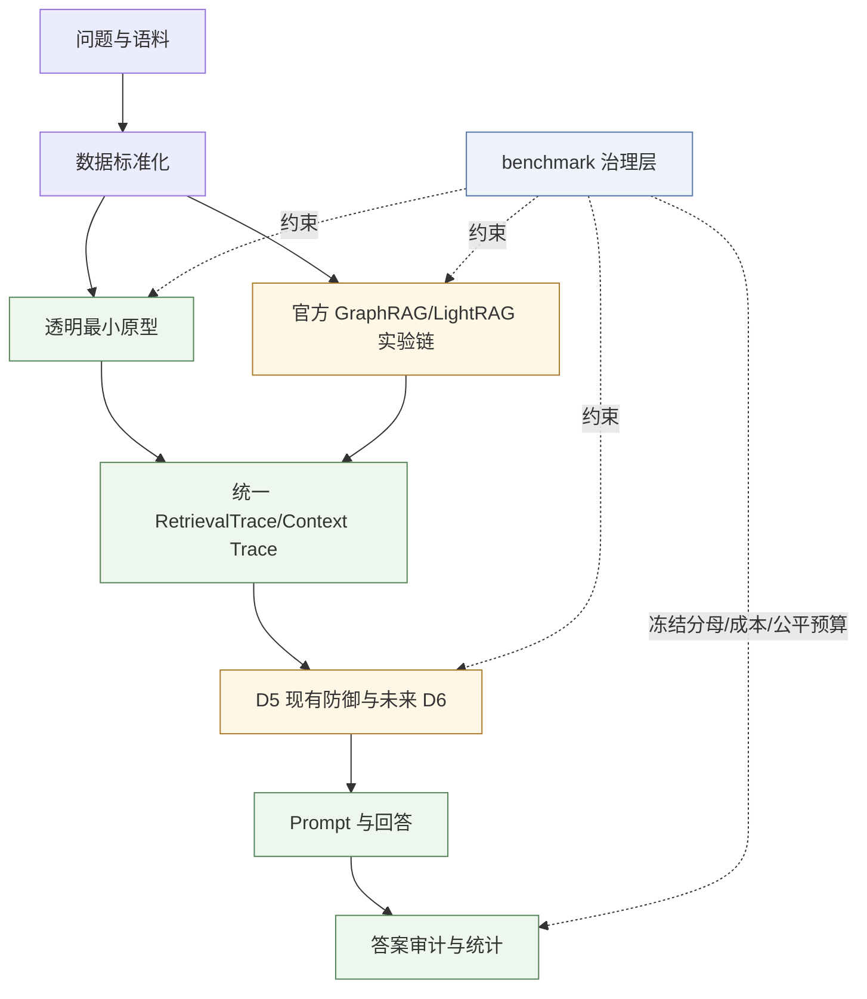
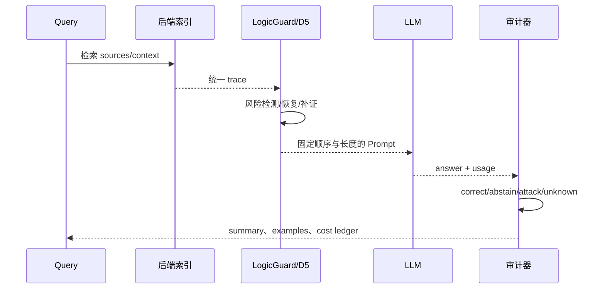

# LogicGuard 完整框架与研究思路

> 源码基准：`1bad5928753a786261d98637094115334eba3fbf`<br>
> 仓库：[ATerLu/Logicguard-research-new](https://github.com/ATerLu/Logicguard-research-new)<br>
> 适合：重新接手项目、需要从 0 建立心智模型的开发者和研究者

## 阅读路线

| 读者 | 建议阅读方式 |
|---|---|
| 小白 | 按全文顺序读，先理解例子，再打开源码 |
| 后端开发者 | 重点看架构图、数据契约、主链和模块边界 |
| 研究者/老手 | 先看“D5 与 D6”“benchmark 治理”“当前状态”，再回看代码 |

## 1. 类比开场：LogicGuard 是一套“被投毒图书馆的审计系统”

想象一个图书馆：读者提出一个多跳问题，管理员先从书架找几本书，再把摘录交给回答员。攻击者偷偷改了一本书，或者放了一本“看起来非常相关”的假书。回答员只看摘录，就可能给出错误答案。

LogicGuard 不只是把可疑书扔掉。它要回答四个问题：这段证据是否可疑？能否找到可信替代书？替代书是否真的支持完整推理链？如果仍然无法验证，应该扩展检索还是明确拒答？

这就是项目的核心：**在 GraphRAG/RAG 受到逻辑投毒时，尽量同时保住安全性和可答性。**

> 📦 **额外知识：RAG 与 GraphRAG**<br>
> RAG 是“先检索资料，再让模型回答”；GraphRAG 额外把文档、实体和关系组织成图，让系统可以沿多跳关系找证据。图能帮助发现桥接关系，也会放大攻击者注入的错误关系。

## 2. 一句话看懂项目

LogicGuard 不是一个已经封装好的在线服务，而是一个 **YAML 驱动、以 JSONL/CSV/manifest 传递中间结果的科研实验框架**：它生成或读取污染语料，接入不同检索后端，构造防御上下文，调用回答模型，最后用固定分母和审计规则评估结果。

### 为什么仓库里有这么多 Stage？

它记录的是研究问题的演进，不是一个应用依次执行的几十个步骤。按“上一阶段暴露什么问题，下一阶段解决什么问题”读，比按编号从头读有效：

| 研究阶段 | 要解决的问题 | 留下的认识 |
|---|---|---|
| 轻量原型与模拟攻击 | 污染能否进入图检索和回答？ | 可以用小样例看清攻击与路径的关系 |
| 风险过滤 | 删除污染后是否就安全可用？ | 安全性提升可能伴随空上下文和拒答 |
| Oracle 恢复 | 如果知道正确干净文档，能否恢复可答性？ | 这是信息上界，不是部署能力 |
| 非 Oracle 恢复与补证 | 不知道正确对应文档时，能否找到替代证据？ | 候选召回、误替换与缺失第二跳成为问题 |
| Stage47 自适应攻击 | 攻击者知道规则后能否绕过防御？ | 低漂移、自然假桥、候选碰撞暴露不同盲区 |
| Stage48 重建索引 | 攻击能否从真实语料一路传播到最终答案？ | 上下文注入有效不代表自然检索暴露有效 |
| v1.2 / WP1–WP5 | 如何公平验证新方法，避免只证明理想条件？ | 固定分母、可信对照、恢复正确性与独立确认集成为核心 |

研究方向不是“阈值越调越多”，而是从风险过滤走向可验证的证据恢复。历史叙述见 [methodology.md](https://github.com/ATerLu/Logicguard-research-new/blob/1bad5928753a786261d98637094115334eba3fbf/docs/methodology.md#L29)，新方法设计见 [thesisPlan.md](https://github.com/ATerLu/Logicguard-research-new/blob/1bad5928753a786261d98637094115334eba3fbf/docs/thesisPlan.md#L183)。

## 3. 全景图：必须分清三条代码线



这是职责全景，不表示两个后端已经共享一条完整跑通的新 benchmark 命令。现有 Stage43–45 的具体串联以 Microsoft GraphRAG source 管线为主；LightRAG 在新 benchmark 中有后端契约与 trace 适配，不应据此推断所有组合已完成实测。黄色节点包含仍待整合或实现的部分。

另见 [角色与功能图](./logicguard-角色功能图.svg)：研究者负责实验配置与审计，检索后端提供索引与上下文，模型服务提供生成和评分能力。

### 3.1 透明最小原型

这条线最适合第一次学习：

```text
BEIR 风格数据
→ NormalizedSample
→ Entity Swap / Bridge Injection
→ 轻量 GraphRAG-like 或 NaiveRAG
→ RetrievalTrace
→ 风险打分、重排、过滤、可信回填
→ 离线指标
```

入口分别是 [schemas.py](https://github.com/ATerLu/Logicguard-research-new/blob/1bad5928753a786261d98637094115334eba3fbf/src/logicguard/data/schemas.py#L14)、[builder.py](https://github.com/ATerLu/Logicguard-research-new/blob/1bad5928753a786261d98637094115334eba3fbf/src/logicguard/graph/builder.py#L15)、[retriever.py](https://github.com/ATerLu/Logicguard-research-new/blob/1bad5928753a786261d98637094115334eba3fbf/src/logicguard/graph/retriever.py#L20)。

### 3.2 官方 GraphRAG 实验链

这条线面向真实后端适配：

```text
clean/attacked corpus
→ Microsoft GraphRAG 建索引
→ 官方 query/context
→ 统一 source trace
→ Stage43 风险检测与恢复
→ Stage44 补证
→ Stage45 二跳候选追加
→ 固定 prompt 渲染
→ LLM answer
→ 本地审计/可选 judge
```

官方上下文桥接在 [official_query_pipeline.py](https://github.com/ATerLu/Logicguard-research-new/blob/1bad5928753a786261d98637094115334eba3fbf/src/logicguard/ms_graphrag/official_query_pipeline.py#L191)。新 benchmark 再通过 [backend_trace_adapters.py](https://github.com/ATerLu/Logicguard-research-new/blob/1bad5928753a786261d98637094115334eba3fbf/src/logicguard/benchmark/backend_trace_adapters.py#L19) 为 Microsoft GraphRAG 与 LightRAG 建立共同 trace 契约。

### 3.3 benchmark 治理层

benchmark 不是第四种检索器，而是实验“裁判和会计”：定义攻击终点、输入输出契约、可信池、固定预算、成本、hash、unknown 和统计分母，防止“换了攻击定义、拿了额外信息或只报告成功样本”。

> 📦 **额外知识：为什么科研代码需要 manifest/hash**<br>
> 实验不是只看一张最终表。配置、数据、Prompt、上游源码和中间产物任何一个变化，都可能让结果不可比。manifest 把这些输入的身份和 SHA-256 固定下来，JSONL 则保存可逐条审计的记录。

## 4. 技术栈速览

| 维度 | 选型 | 大白话 |
|---|---|---|
| 语言 | Python 3.11 | 研究编排、数据处理、评估和 CLI |
| 构建/依赖 | `uv`、`uv.lock` | 锁住可复现实验环境 |
| 配置 | YAML | 一份配置就是一次实验配方 |
| 中间结果 | JSONL、CSV、JSON、Markdown | 可追加、可审计、可读 |
| 轻量图 | NetworkX | 教学和机制原型的文档—实体图 |
| 传统检索 | BM25 / dense / hybrid | 非图基线和可信候选排序 |
| 官方后端 | Microsoft GraphRAG、LightRAG | 真实后端接入，使用隔离环境 |
| 模型调用 | OpenAI-compatible client | 回答、攻击生成、judge；密钥来自环境变量 |
| 质量门 | pytest、ruff、hash、manifest | 判断逻辑、格式和实验身份是否稳定 |

## 5. 数据层：先把四张表合成一个样本对象

### Step 1：读取原始数据

**这一步在干嘛**：读取 `queries.jsonl`、`answers.jsonl`、`corpus.jsonl` 和 `qrels/test.tsv`，检查 query ID、答案、文档和支持关系是否对齐。<br>
源码：[loader.py](https://github.com/ATerLu/Logicguard-research-new/blob/1bad5928753a786261d98637094115334eba3fbf/src/logicguard/data/loader.py#L30)

### Step 2：标准化成 `NormalizedSample`

**这一步在干嘛**：把一个问题需要的 query、gold answer、support doc IDs 和完整 support documents 放在同一个对象中，后续模块不再反复 join 多张表。<br>
源码：[prepare.py](https://github.com/ATerLu/Logicguard-research-new/blob/1bad5928753a786261d98637094115334eba3fbf/src/logicguard/data/prepare.py#L83)<br>
核心对象：[schemas.py](https://github.com/ATerLu/Logicguard-research-new/blob/1bad5928753a786261d98637094115334eba3fbf/src/logicguard/data/schemas.py#L39)

```python
NormalizedSample(
    query_id="q1",
    query="Who is the mother of the director of Atomised?",
    answer="Gisela Elsner",
    support_doc_ids=["d1", "d2"],
    support_docs=[...],
)
```

### Step 3：生成确定性子集

实验配置决定 full-500、debug-50、dev60 等范围；选择必须在攻击成败、gold 和 recovery outcome 之前完成，不能观察结果后挑样本。

## 6. 轻量 GraphRAG：用最小模型看懂多跳路径

### Step 1：抽实体

[entities.py](https://github.com/ATerLu/Logicguard-research-new/blob/1bad5928753a786261d98637094115334eba3fbf/src/logicguard/graph/entities.py#L35) 用大写短语、括号内容和年份做确定性规则抽取，并把表面形式规范化成稳定 key。它不是生产级 NER，而是为了离线、可解释、可复现。

### Step 2：构建文档—实体二部图

[builder.py](https://github.com/ATerLu/Logicguard-research-new/blob/1bad5928753a786261d98637094115334eba3fbf/src/logicguard/graph/builder.py#L15) 创建 `doc:<id>` 和 `ent:<normalized>` 节点，文档提到实体就连边。

### Step 3：沿路径检索

[retriever.py](https://github.com/ATerLu/Logicguard-research-new/blob/1bad5928753a786261d98637094115334eba3fbf/src/logicguard/graph/retriever.py#L20) 从 query entity 做最短路径检索。`max_depth=3` 能表达：

```text
query entity → document A → bridge entity → document B
```

所有结果被保存为 `RetrievalTrace`，它是早期防御和审计的核心中间对象，定义见 [graph/schemas.py](https://github.com/ATerLu/Logicguard-research-new/blob/1bad5928753a786261d98637094115334eba3fbf/src/logicguard/graph/schemas.py#L61)。

### 一个具体例子

问题（教学虚构例子）：“谁执导了 Film Alpha，并且出生于 Stone City？”

这个例子的答案是 Raj Kanwar；我们需要同时验证“执导电影”和“出生于该城市”两项事实。

- `d1`：Film Alpha was directed by Raj Kanwar。
- `d2`：Raj Kanwar was born in Stone City。
- 一条可能路径是 Film Alpha → `d1` → Raj Kanwar → `d2`；实际检索也可能从问题中的 Stone City 等实体直接命中证据，不固定访问顺序。

如果只看到 `d1` 中的 Raj Kanwar，答案词已经出现，但还没有证据满足“出生于 Stone City”的条件。例子只用于说明两跳证据，不是现实人物传记或真实实验结果。

> 📦 **额外知识：support hit、answer surface、chain complete**<br>
> support hit 是“支持文档 ID 出现在上下文”；answer surface 是“答案字符串出现在上下文”；这里的 chain complete 是项目离线代理：支持文档全部命中，且按 source_state/recovery 标记没有未恢复的支持来源；它不是对每个事实关系的语义证明。三者不是同一个指标，答案词出现不等于推理链完整。

## 7. 攻击层：污染如何进入系统

### 7.1 早期可控攻击

- **Entity Swap**：在支持文档中把正确答案实体替换成另一个答案。见 [entity_swap.py](https://github.com/ATerLu/Logicguard-research-new/blob/1bad5928753a786261d98637094115334eba3fbf/src/logicguard/attack/entity_swap.py#L21)。
- **Bridge Injection**：追加同时提到 query entity 和错误答案的假文档，制造一条“看起来合理”的桥。见 [bridge_injection.py](https://github.com/ATerLu/Logicguard-research-new/blob/1bad5928753a786261d98637094115334eba3fbf/src/logicguard/attack/bridge_injection.py#L26)。

这两种攻击是学习机制的最好入口：一个改原文，一个加新文档。

### 7.2 v1.2 benchmark 攻击族

| 攻击 | 目标 | 不能和谁混算 |
|---|---|---|
| A1 PoisonedRAG | targeted wrong answer | 不能和 A2 clean-correct flip 混算 |
| A2 LogicPoison | clean-correct → attacked-wrong | 需要先确认 clean 正确 |
| A3 GRAGPoison | relation targeted/untargeted | 关系终点和单位需先冻结 |
| A4 BadRAG | trigger payload success + clean false activation | 独立后门轨 |

早期 Entity Swap 和 answer-aware Bridge Injection 会使用答案/support 信息做受控扰动，不能包装成标签盲攻击。新的公共 benchmark 则将攻击者输入和 evaluator-only 标签分开；这是两个不同威胁设定。

A1/A3 的 question-only 请求契约在 [execution_protocols.py](https://github.com/ATerLu/Logicguard-research-new/blob/1bad5928753a786261d98637094115334eba3fbf/src/logicguard/benchmark/execution_protocols.py#L45)；A2 的 global → query → logic → corpus 管线在 [logicpoison_pipeline.py](https://github.com/ATerLu/Logicguard-research-new/blob/1bad5928753a786261d98637094115334eba3fbf/src/logicguard/benchmark/logicpoison_pipeline.py#L290)。

### 7.3 自适应攻击

Stage47 的攻击生成读取 question、retrieved sources 和 candidate shortlist，不向生成 Prompt 提供 gold/support/changed labels。三个家族是：low_drift（少改实体但改关键事实）、natural_bridge（加入自然的假推理桥）、candidate_collision（利用相似候选诱导错误恢复）。

Stage47 主要是后检索 source perturbation：先把攻击内容放入上下文，再研究防御行为，因此不证明攻击能自行被真实检索器选中。Stage48 再把冻结攻击物化到完整语料、重建索引并观测真实检索/Prompt 暴露；这是攻击现实性验证，而不是同一个上下文注入实验改名字。

## 8. 防御层：从“删坏证据”走向“恢复证据”

### 8.1 早期风险打分

[features.py](https://github.com/ATerLu/Logicguard-research-new/blob/1bad5928753a786261d98637094115334eba3fbf/src/logicguard/defense/features.py#L9) 使用透明特征：直接 query entity 命中、来源是否已知、内容是否相对参考变化、来源冗余度、桥实体支持等。

[reranker.py](https://github.com/ATerLu/Logicguard-research-new/blob/1bad5928753a786261d98637094115334eba3fbf/src/logicguard/defense/reranker.py#L10) 计算：

```text
adjusted_score = base_score - risk_penalty × risk_score
```

然后可以重排、过滤高风险候选，再从 clean/reference trace 回填。这个阶段最重要的认识是：**只过滤通常会降低污染暴露，但也会让上下文变空。**

### 8.2 D5：当前已有的 Stage43–45 组合

最清晰的串联入口是 [reindex_defense_matrix.py](https://github.com/ATerLu/Logicguard-research-new/blob/1bad5928753a786261d98637094115334eba3fbf/src/logicguard/evaluation/reindex_defense_matrix.py#L189) 的 `build_stage48_defense_matrix()`：依次调用风险恢复、普通补证、二跳补证，并保留各版本上下文作配对比较。

#### Stage43：risk-non-oracle recovery

[risk_aware_recovery.py](https://github.com/ATerLu/Logicguard-research-new/blob/1bad5928753a786261d98637094115334eba3fbf/src/logicguard/defense/risk_aware_recovery.py#L225) 为当前 source 找 clean candidate，比较标题重合和实体漂移：实际 Stage43 YAML 通常是 `title_overlap >= 0.80`、`entity_drift >= 0.10`、候选 top-5。

要注意三点：

1. 找不到 candidate 时是 `unverifiable`，不等于 `verified_safe`；
2. entity drift 是规则 token 集合差异，不是事实逻辑证明；
3. 只改数字、年份或自然桥接关系，可能不触发该启发式。

#### Stage44：source enrichment

[source_enrichment.py](https://github.com/ATerLu/Logicguard-research-new/blob/1bad5928753a786261d98637094115334eba3fbf/src/logicguard/defense/source_enrichment.py#L493) 在恢复后的上下文中，按 query BM25/标题重合追加可信候选。研究配置通常从 baseline top-8 扩到 top-12，每个 source 截断为约 450 字符。

#### Stage45：second-hop append

[chain_completion.py](https://github.com/ATerLu/Logicguard-research-new/blob/1bad5928753a786261d98637094115334eba3fbf/src/logicguard/defense/chain_completion.py#L282) 从当前 source 的标题和实体中抽 bridge terms，再用 query + bridge terms 排序 clean candidate，在有空位时追加到 top-14。

关键纠偏：当前实现不是“先证明链不完整，再触发追加”的在线证明器；它对每个 context 生成 targeted append，`chain_complete` 主要是后验离线诊断，定义见 [chain_completion.py](https://github.com/ATerLu/Logicguard-research-new/blob/1bad5928753a786261d98637094115334eba3fbf/src/logicguard/defense/chain_completion.py#L690)。

### 8.3 两条硬边界：D5 与 D6

| 名称 | 当前状态 | 含义 |
|---|---|---|
| D5 | 已有 Stage43–45 冻结基线 | 风险检测、候选恢复、补证和二跳追加 |
| D6 | 只有接口/研究设计，尚未完成 | claim、provenance、path、recovery integrity 四组件 |

D6 目标动作是 `accept / recover / expand / abstain`：证据可靠就接受，风险高就恢复，候选不足就扩检索，仍不可验证就拒答。它不是“再加几个阈值”，而是要验证恢复后的 claim、来源独立性和多跳链完整性。

> 📦 **额外知识：oracle 与 non-oracle**<br>
> oracle 指运行时直接知道答案、support doc ID 或精确 clean 对应关系；它可以作为上界，但不能冒充真实部署能力。non-oracle 只是不直接使用这些标签，仍可能依赖可信 candidate pool，所以不能理解成“完全没有可信资料”。

### 8.4 为什么 D6 要拆成四个组件？

以下是 [thesisPlan.md](https://github.com/ATerLu/Logicguard-research-new/blob/1bad5928753a786261d98637094115334eba3fbf/docs/thesisPlan.md#L236) 的拟议设计，不是已完成算法：

| 组件 | 大白话 | 要防止的错误 |
|---|---|---|
| Claim decomposition | 把长段落拆成“谁与谁有什么关系”的原子命题 | 一段话整体相关，却悄悄改了关键出生地、作者或隶属关系 |
| Source provenance | 查来源身份、版本、派生关系和独立性 | 三个攻击者复制的 chunk 被当成三份独立证据 |
| Path completeness | 检查问题所需各跳是否都有证据支撑 | 答案词出现了，但另一个限制条件没有依据 |
| Recovery integrity gate | 对替代候选也执行相关性、命题兼容、来源和链完整性硬约束 | 原 source 被删了，却换进同名错误文档或攻击者布置的候选 |

“恢复”必须比“选一个排名最高的候选”更严格。设计允许先做候选打分，但若来源仍属于同一攻击派生链，或者关键命题与可信证据冲突，高分也不能覆盖硬约束。找不到合格候选应走 `expand`，预算耗尽则 `abstain`。

这也解释了双重要求：推理路径看起来连贯，不代表事实可靠；来源看起来可信，不代表它覆盖了回答所需的全部推理步骤。两者都满足，才有资格谈“可验证恢复”。

## 9. 官方 GraphRAG 与回答链

### Step 1：官方上下文导出

[official_query_pipeline.py](https://github.com/ATerLu/Logicguard-research-new/blob/1bad5928753a786261d98637094115334eba3fbf/src/logicguard/ms_graphrag/official_query_pipeline.py#L191) 生成临时配置，调用隔离 GraphRAG 环境，读取 `context_data.sources`。

### Step 2：query-layer 控制

[query_layer_context.py](https://github.com/ATerLu/Logicguard-research-new/blob/1bad5928753a786261d98637094115334eba3fbf/src/logicguard/ms_graphrag/query_layer_context.py#L128) 通过 include/exclude entity names 影响官方 LocalSearchMixedContext，输出 query/method 级 context rows。

### Step 3：固定 prompt 与回答

[answer_generation.py](https://github.com/ATerLu/Logicguard-research-new/blob/1bad5928753a786261d98637094115334eba3fbf/src/logicguard/evaluation/answer_generation.py#L309) 从 context rows 构造 case，按 rendering policy 固定 source 顺序、截断和 prompt，然后调用 OpenAI-compatible client。

### Step 4：离线回答审计

[answer_audit.py](https://github.com/ATerLu/Logicguard-research-new/blob/1bad5928753a786261d98637094115334eba3fbf/src/logicguard/evaluation/answer_audit.py#L284) 对历史回答做归一化、拒答检测、来源与错误归因。correct/partial/incorrect/abstained 属于回答质量；targeted success 则要求命中事先定义的恶意目标，应由相应攻击评估器判定。

注意历史口径不同：部分旧 answer/judge 管线将“错误回答且残留污染”记为广义 attack success，不能拿它替代新版 benchmark 的 targeted ASR；判断某个 CSV 的意义必须看生成它的具体函数和配置。judge（另一个模型评分）也不是客观真理，需要保留原回答、裁决理由并进行人工盲审。



## 10. benchmark：如何保证比较公平

### 10.1 Contracts

[contracts.py](https://github.com/ATerLu/Logicguard-research-new/blob/1bad5928753a786261d98637094115334eba3fbf/src/logicguard/benchmark/contracts.py#L11) 用 `AdapterContract` 描述输入 schema、输出 schema、数据集、后端、攻击终点、实现状态和是否有资格排名。

### 10.2 Trusted pool 与 T0/T1

[trust_manifest.py](https://github.com/ATerLu/Logicguard-research-new/blob/1bad5928753a786261d98637094115334eba3fbf/src/logicguard/benchmark/trust_manifest.py#L77) 按 source group 分配 100%、50%、20%、0% coverage；分配在投毒前完成，且不读取 gold。

[trusted_controls.py](https://github.com/ATerLu/Logicguard-research-new/blob/1bad5928753a786261d98637094115334eba3fbf/src/logicguard/benchmark/trusted_controls.py#L38) 定义：

- T0：只从可信池检索；
- T1：普通 live + trusted RRF augmentation，使用相同预算；
- D0：攻击后端、不做防御；
- D7：精确 clean 映射 oracle 上界，只用于诊断。

> 📦 **额外知识：BM25、Embedding 和 RRF**<br>
> BM25 是词项匹配打分：重要关键词在文档中出现得越合适，排名越高。Embedding 将文本转成向量以比较语义相似度。RRF 根据各路结果的名次融合，典型贡献为 `1/(k+rank)`，不要求不同检索器分数处于同一量纲。

T0/T1 是公平控制，不是 LogicGuard 本身。D6 如果比 T1 多看候选、多用 token 或获得额外 pool，就不能证明方法更好。

公开基准里的 trusted pool 是投毒前冻结的 protected snapshot（受保护快照），用来模拟部署中的可信资料来源，不是一个能够判定所有客观事实的万能真值库。0% coverage 或某题没有可用可信支持时，必须承认不可验证的边界。

### 10.3 漏斗与指标

```text
attempted
→ generation_valid
→ evaluation_valid
→ index_included
→ graph_surfaced
→ retrieved
→ prompt_exposed
→ answered
→ threat-native-success
```

上面的箭头表示检查顺序，不表示当前 v1.2 要求所有图诊断集合严格包含：某后端可能从 text unit 检索而没有对应 graph-surfaced 事件。应分别保留 provenance（来源血缘）与 trace，不强行让所有计数变成单调漏斗。旧 v1.1 的 `FunnelCounts` 有严格单调合同，不应不加区分地套到新版所有图诊断上。

A1 使用 targeted success / fixed attempted；A2 使用 clean-correct attack flip；A3 先冻结 relation endpoint；A4 单独报告 trigger success 和 false activation。unknown、usage missing、in-flight、基础设施失败必须单列或报告上下界，不能静默算攻击失败。

[amendment_metrics.py](https://github.com/ATerLu/Logicguard-research-new/blob/1bad5928753a786261d98637094115334eba3fbf/src/logicguard/benchmark/amendment_metrics.py#L9) 提供 unknown、clean-correct flip 和 paired defense effect 等纯函数。

### 10.4 D0–D7 全部编号如何看

| 编号 | 方法或对照 | 当前阅读边界 |
|---|---|---|
| D0 | 无防御 | 给攻击提供基准，不能缺 clean 配对 |
| D1 | Query paraphrase：改写问题 | 合同登记不等于完整 dev60 效果已完成 |
| D2 | PPL/PTI 过滤 | 语言异常/过滤类基线，需对应实现和资格证据 |
| D3 | RAGDefender | 固定模型锚点通过；有输入顺序与论文公式差异限制 |
| D4 | HoG-GRAG | 固定官方工件有编译/Prompt 缺失问题，当前不可用 |
| D5 | 旧 LogicGuard Stage43–45 | 冻结历史基线，不能与新方法混称 |
| D6 | 新 LogicGuard 四组件 | 尚未实现完整方法，不能报告其效果 |
| D7 | Oracle clean recovery | 信息上界，不进入现实方法排名 |

PPL（困惑度）粗略衡量一段文本对语言模型有多意外；“文本不自然”和“事实被篡改”不是同一个问题。因此不能预设这类过滤器能发现自然流畅的假事实。

### 10.5 什么才算防御改善

不能只报被阻断的攻击数：防御也可能把原本正确的证据换坏。新指标同时计算“D0 攻击成功→防御后失败”与“D0 失败→防御后成功”，用两者之差表示配对净改善。

还要一起看 clean/attacked EM（答案归一化后完全匹配）、token F1（答案词项重合）、拒答率、回答覆盖、正确/错误/未决恢复、调用数、延迟和费用。旧表的 utility 有自己的 partial 计分规则，不能未经核对就当成 EM。

一个教学例子：固定 10 次尝试，明确成功 2 次，明确失败 6 次，2 次网络异常，则成功率界限是 2/10 到 4/10；不能报告成已确定的 20%。同一问题跨攻击/后端产生的多行也不是完全独立样本。

## 11. dev60 与当前研究状态

[dev60_launch.py](https://github.com/ATerLu/Logicguard-research-new/blob/1bad5928753a786261d98637094115334eba3fbf/src/logicguard/benchmark/dev60_launch.py#L387) 只做离线冻结：60 个问题、180 个固定攻击尝试、300 个最大请求槽、攻击生成 hard cap ¥8.681760。

[request_cost_guard.py](https://github.com/ATerLu/Logicguard-research-new/blob/1bad5928753a786261d98637094115334eba3fbf/src/logicguard/benchmark/request_cost_guard.py#L53) 的目标是 `reserve → single call → reconcile`，unknown/in-flight fail-closed；但当前 manifest 仍是 `paid_dispatch_allowed=false`，三个 paid runner 尚未完全绑定 exact launch fingerprint。

dev60 的计数要分开理解：60 问 × 3 个主攻击 = 180 attempts；A1 每问 1 次、A2 query 抽取每问 1 次、A3 每问 3 阶段，所以最多 60+60+180=300 请求槽。两后端复用同一份冻结攻击资产，不再各生成一次。120 个 clean query-backend 配对和 360 个 attacked 配对是评测单位，不是 API 次数，更没有包含防御数/覆盖档带来的扩张。

¥8.681760 只是攻击生成预算，不包括双后端索引、embedding、回答和 judge。A2 完成四阶段不代表每阶段都要调用 LLM：global/logic/corpus 含大量确定性本地处理，query 抽取才对应这里的付费请求槽。

当前研究路线：

| WP | 内容 | 状态 |
|---|---|---|
| WP1 | 历史审计、协议修订、attack fidelity、trusted controls | 完成 |
| WP2 | dev60、攻击语料、clean baseline、D3/D4、T0/T1、后端 trace | 部分完成 |
| WP3 | D6 四组件、claim/provenance/path/recovery gate、消融 | 待做 |
| WP4 | 新确认集、三数据集×双后端正式比较 | 未解锁 |
| WP5 | 自适应评测、跨模型、统计、盲审、复现表 | 未开始 |

Stage48 Gate A 已失败关闭。历史 natural-bridge `4/20` 是已选有效/索引子集内的 system 比例，`4/4` 是暴露条件比例，不能改写为 fixed-50 总尝试 ASR，更不能用一个家族成功宣称整个 Gate A 通过。旧三组各 500 问已有历史执行记录，不自动意味着标签泄漏，但不能直接认证为新确认集。

A2 四阶段有本地 fixture（小型已知输入样例）验证；A1/A3 有公开资产与两个 pilot 的物化；D3 有固定模型锚点；它们分别证明部分机制和接口，不等于完整 dev60 效果验证。真实 trusted-pool 检索、D6 和正式统计排名都仍待完成。

当前事实源优先级：`handoff.md` 顶部、`configs/benchmark/comparison_v1_2_protocol.yaml`、`docs/comparativeExperimentPreregistration_v1.2.md`。README 和论文计划后半段包含历史阶段，不能直接用其中旧的“下一步”判断当前状态。

## 12. 目录、对象和运行方式速查

### 12.1 哪些目录是方法，哪些目录是实验工具

| 目录 | 责任 | 学习优先级 |
|---|---|---|
| `data/` | 加载、标准化、成对语料差异 | 必看输入 |
| `graph/`、`naive_rag/` | 透明图原型与普通检索 | 最适合入门 |
| `attack/` | 早期扰动、Stage47 自适应生成 | 理解威胁 |
| `defense/` | 风险、恢复、补证、二跳追加 | 现有方法核心 |
| `ms_graphrag/` | 官方工作区/索引/上下文适配；部分是兼容入口 | 接真实后端时看 |
| `llm/` | Provider、Prompt、基础答案判定和 judge | 外部模型边界 |
| `evaluation/` | 回答、preflight、重建索引诊断、配对审计 | 理解证据如何形成 |
| `benchmark/` | 公共攻击、多后端、可信对照、资格与费用 | 当前开发重点 |
| `core/` | YAML 路径、IO、hash、checkpoint、指标 | 理解底层保障 |
| `experiments/`、`reports/` | 早期编排、报告、实验注册 | 用到再查 |
| `configs/` | 输入/输出/阈值/模型/模式 | 必须与源码一起读 |
| `tests/`、`artifacts/` | 可执行样例、冻结证据 | 必看验证材料 |
| `tools/`、`vendor/` | 隔离依赖和固定上游 | 恢复重环境时看 |
| `docs/`、`papper/`、`papper2/` | 研究叙事和论文资料 | 按当前问题选读 |

### 12.2 五种对象别混起来

1. `NormalizedSample`：方便研究和评价的全信息样本，包含答案与 support；不是天然可发给攻击者的对象。
2. `BenchmarkQuery`：攻击者可见的 question、query ID、split/stratum 等，不含 gold。
3. `PathCandidate / RetrievalTrace`：早期检索输出，保留 doc ID、路径、桥实体和分数。
4. official `context_data.sources` 与 normalized backend hit：真实后端交出的证据文本、文档/来源组标识和排名。
5. answer result / audit row / manifest：分别记录模型响应、评价判断、运行身份。不要把模型输出与裁判判断合成一个不可追溯字段。

doc_id 标识原始文档，text_unit_id 标识切块，source_group_id 归并同一来源的相关片段。多个 chunk 不自动等于多个独立来源；同一个 doc_id 的 poisoned/clean 正文也不是同一证据状态。

### 12.3 CLI 不是一台常驻服务

`pyproject.toml` 注册 `logicguard = logicguard.cli:main`。典型流程是：

```text
logicguard run <step> --config <yaml>
→ resolve_config_path（处理配置别名）
→ 分发到职责模块 main()
→ 读取配置与输入产物
→ run_from_config()/run()
→ JSONL、CSV、manifest、报告
```

不是所有新模块都接进统一 CLI，部分走 `python -m logicguard.benchmark.<module>`。这些只是入口形式，不是“可随意运行”的安全保证。查看状态优先读取已有 summary，而不是重跑 readiness。

`ms_graphrag/stageNN_*.py` 很多是兼容导入；Stage43 复用 Stage28，Stage44 复用 Stage35，Stage45 复用 Stage38，说明阶段编号是实验历史，不是一个模块必须对应一个 stage。

### 12.4 配置、资产和成本边界

YAML 通常决定数据路径、样本范围、阈值、模型、run mode 和输出 namespace；代码决定计算规则。namespace 可以理解为一次实验专属的产物目录，不应把不同参数的结果写进去混用。

Git 镜像不包含完整 `data/`、`outputs/`、`vendor/upstream/` 和虚拟环境。外部资产恢复依据 `WORKSTATION_HANDOFF.md` 和 `EXTERNAL_ASSETS_SHA256.tsv`；不能见文件缺失就重新生成已冻结付费产物。

模型请求、索引、embedding、judge 都可能花钱。dev60 的 guard 设计是调用前预留、调用后核账；未知请求停止，不盲重试。但上一轮审查已发现旧 runner 和 checkpoint 路径存在缺陷，设计目标不等于全项目已满足保证，详见 [全面审查报告](../reviews/2026-10-10/全面审查.md)。

## 13. 最容易混淆的 10 个概念

1. `graph/` 轻量图 ≠ Microsoft GraphRAG 官方后端。
2. `full_query_guard` 是历史 query-layer/上下文基线 ≠ 完整 D6。
3. Stage43–45 是 D5 现有冻结链 ≠ D6 四组件方法。
4. T0/T1 是公平控制 ≠ LogicGuard 防御。
5. D7 是 oracle 上界 ≠ 可部署方法。
6. `support hit` ≠ `answer surface` ≠ `chain complete`。
7. generation-valid ≠ evaluation-valid ≠ prompt-exposed ≠ attack success。
8. coverage 是可信 source group 覆盖率 ≠ 事实正确率。
9. dev60 的 attempts、request slots、query-backend pairs 是不同计数单位。
10. “non-oracle” 不等于不依赖可信候选池。

## 14. 推荐阅读顺序

| 顺序 | 文件/目录 | 学什么 | 预计 |
|---:|---|---|---:|
| 1 | [handoff.md](https://github.com/ATerLu/Logicguard-research-new/blob/1bad5928753a786261d98637094115334eba3fbf/handoff.md#L1) | 当前事实源、禁止事项、WP2 状态 | 15 分钟 |
| 2 | [comparison_v1_2_protocol.yaml](https://github.com/ATerLu/Logicguard-research-new/blob/1bad5928753a786261d98637094115334eba3fbf/configs/benchmark/comparison_v1_2_protocol.yaml#L1) | 研究问题、攻击/防御/指标契约 | 20 分钟 |
| 3 | [schemas.py](https://github.com/ATerLu/Logicguard-research-new/blob/1bad5928753a786261d98637094115334eba3fbf/src/logicguard/data/schemas.py#L14) → loader → prepare | 数据如何进入系统 | 20 分钟 |
| 4 | graph schemas → builder → retriever | 文档—实体—路径 | 30 分钟 |
| 5 | entity_swap → bridge_injection | 污染如何制造 | 20 分钟 |
| 6 | features → reranker → non_oracle_recovery | 早期风险与恢复演进，理解 oracle 边界 | 40 分钟 |
| 7 | risk_aware_recovery → source_enrichment → chain_completion | Stage43–45 主链 | 45 分钟 |
| 8 | official_query_pipeline → query_layer_context | 官方 GraphRAG 接入 | 30 分钟 |
| 9 | answer_generation → answer_audit → judge | 上下文如何变成评测结论 | 30 分钟 |
| 10 | contracts → trusted_controls → dev60 → request_cost_guard | 公平、成本和实验身份 | 45 分钟 |

## 15. 安全动手练习

先跑不需要外部数据、不调用 provider、不会写冻结资产的测试：

```bash
# 从仓库根目录执行（包含 pyproject.toml 的目录）
uv run --frozen --group dev pytest -q \
  tests/test_ms_graphrag_stage28_risk_non_oracle_recovery.py \
  tests/test_ms_graphrag_stage35_source_enrichment.py \
  tests/test_ms_graphrag_stage38_chain_completeness.py
```

已验证结果：14 passed。这些测试使用内存数据或 pytest 的 `tmp_path` 临时目录。更基础的一组也已验证 17 passed：

```bash
uv run --frozen --group dev pytest -q \
  tests/test_graphrag_baseline.py tests/test_trust_manifest.py \
  tests/test_trusted_controls.py tests/test_amendment_metrics.py
```

这两组只是学习起点，不证明全部代码无缺陷。上轮全量审查为 312 passed / 36 failed，主要受外部资产、依赖和一个 Linux 路径断言影响；部分历史测试还会写冻结产物，所以不要直接在原工作树随意跑全量 pytest。

推荐三个练习（只在测试 fixture/临时目录中做，不改冻结资产）：


1. 修改一个 toy corpus，观察 Entity Swap 与 Bridge Injection 的 trace 差异。
2. 构造只有 `d1` 的两跳上下文，确认会出现 `answer_surface_without_full_chain`；再追加 `d2`，观察 `chain_complete` 变化。
3. 给 Stage43 candidate pool 删除候选，观察 `unverifiable` 与 `verified_safe` 的区别。

排错顺序固定为：先看 YAML 输入/输出路径 → 再看 JSONL 中间行 → 再看 manifest/hash → 最后看 provider 或重型后端日志。不要一上来重跑历史全量命令。

## 16. 你真正需要建立的心智模型

这个项目不是“一个 detector 的代码”，而是一条实验论证链：

```text
攻击是否真实生成？
→ 是否进入索引？
→ 是否被检索？
→ 是否进入最终 Prompt？
→ 模型是否因此答错？
→ 防御是否降低错误？
→ 是否只是靠拒答或额外信息换来的？
→ 恢复的证据是否真的可信且链条完整？
```

每一个箭头都对应代码、产物、指标和可能的 unknown。读代码时始终问自己：这一层是在改变系统行为，还是在证明上一层的行为？

> 📦 **额外知识：为什么安全和可用性必须同时看**<br>
> 只删可疑 source，攻击暴露可能下降，但答案上下文也可能为空；只追加更多 source，答案词可能出现，但污染和误导也可能一起进入。LogicGuard 的研究价值不在“某个阈值更高”，而在于把安全、恢复、链完整性和最终回答放进同一条可审计链。

## 17. 回答这 18 个问题，检查是否真正理解

### 开场：能否描述项目

**Q1：LogicGuard 是什么？**<br>
它是针对 RAG/GraphRAG 语料投毒的证据恢复研究原型及实验框架，不是新训练的基础模型。

**Q2：为什么不是过滤掉坏文档就够了？**<br>
删掉多跳链上的关键文档，会让系统安全但不可答；因此还要评价恢复、补证和拒答的代价。

**Q3：最适合先学哪一条线？**<br>
从 `data/schemas → graph/builder → graph/retriever` 和 toy 测试学输入、路径和 trace，不必先下载重模型。

**Q4：D5、D6、benchmark 有什么区别？**<br>
D5 是旧规则恢复链，D6 是拟议四组件方法，benchmark 是验证它们的实验规范和工具。

**Q5：当前是不是已完成？**<br>
不是。WP2 仍在准备，dev60 paid dispatch 禁止，D6 和正式比较尚未完成。

### 原理：能否跟着一个问题走

**Q6：max_depth=3 为什么能找到两跳支持？**<br>
二部图中 entity→doc→bridge entity→doc 是 3 条边；这不等于自然语言问题有 3 个语义推理步骤。

**Q7：早期 trace 有 gold 是否说明排序泄漏？**<br>
不能仅凭对象含标签就下结论；要看消费路径。`retriever._score_path` 明确不使用传入的 gold IDs，但该对象不能未经筛选给攻击生成器。

**Q8：Stage25 为什么仍不算完全去掉 oracle？**<br>
它使候选恢复不按正确 doc_id 查找，但旧风险识别仍借 changed labels；Stage28/43 再去掉风险 oracle。可信池假设依然存在。

**Q9：Stage43 说 verified_safe 就证明事实正确吗？**<br>
不是。它只是当前候选一致性启发式的状态标签，低漂移事实篡改可能漏掉。

**Q10：Stage44 与 Stage45 的检索词有什么区别？**<br>
前者围绕原 query 补证，后者加入当前上下文里的桥实体，使检索能触达原问题没直接提到的第二跳事实。

**Q11：chain_complete 会直接控制 Stage45 是否运行吗？**<br>
当前实现不是这样；先做候选追加，后面才用 support/状态标记计算离线完整性指标。

**Q12：回答上下文含答案词就够了吗？**<br>
不够。需要的另一条件可能没有证据；字符串包含、support 覆盖和模型作答是不同层。

**Q13：T1 为什么重要？**<br>
它排除“LogicGuard 只是比无防御多看了 clean 资料”的解释，要求相同池与预算下比较验证机制的增益。

### 深入：能否避免错误研究结论

**Q14：检索到了污染文档就算攻击成功吗？**<br>
不算。它还可能被过滤或截断，模型也可能忽略；必须追踪实际 Prompt 和攻击原生终点。

**Q15：网络超时可计攻击失败吗？**<br>
不可以。没有观察到结局是 unknown，需要单列/报界限，而非让基础设施质量决定 ASR。

**Q16：为什么不能把三种攻击 ASR 求平均？**<br>
定向回答、clean-correct flip、关系攻击不是同一成功事件与分母；应分攻击族报告。

**Q17：20% trusted coverage 是每题都有 20% 正确证据吗？**<br>
不是。它按 source group 冻结，某题可能没有任何可用可信支持；0% 时应承认不可验证边界。

**Q18：论文的关键贡献应该在哪里？**<br>
在同等信息、预算和回答覆盖条件下证明来源/命题/路径与恢复完整性验证带来净改善，而不是增加几个规则、更多候选或提高拒答率。

这些答案分别对应上文数据、D5、防御控制和指标章节；深入检查入口是 [reindex_defense_matrix.py](https://github.com/ATerLu/Logicguard-research-new/blob/1bad5928753a786261d98637094115334eba3fbf/src/logicguard/evaluation/reindex_defense_matrix.py#L189)、[trusted_controls.py](https://github.com/ATerLu/Logicguard-research-new/blob/1bad5928753a786261d98637094115334eba3fbf/src/logicguard/benchmark/trusted_controls.py#L72) 与 [amendment_metrics.py](https://github.com/ATerLu/Logicguard-research-new/blob/1bad5928753a786261d98637094115334eba3fbf/src/logicguard/benchmark/amendment_metrics.py#L9)。

## 源码索引

| 主题 | 入口 |
|---|---|
| CLI 与配置 | [cli.py](https://github.com/ATerLu/Logicguard-research-new/blob/1bad5928753a786261d98637094115334eba3fbf/src/logicguard/cli.py#L10)、[config.py](https://github.com/ATerLu/Logicguard-research-new/blob/1bad5928753a786261d98637094115334eba3fbf/src/logicguard/core/config.py#L16) |
| 数据 | [loader.py](https://github.com/ATerLu/Logicguard-research-new/blob/1bad5928753a786261d98637094115334eba3fbf/src/logicguard/data/loader.py#L30)、[prepare.py](https://github.com/ATerLu/Logicguard-research-new/blob/1bad5928753a786261d98637094115334eba3fbf/src/logicguard/data/prepare.py#L83) |
| 图检索 | [builder.py](https://github.com/ATerLu/Logicguard-research-new/blob/1bad5928753a786261d98637094115334eba3fbf/src/logicguard/graph/builder.py#L15)、[retriever.py](https://github.com/ATerLu/Logicguard-research-new/blob/1bad5928753a786261d98637094115334eba3fbf/src/logicguard/graph/retriever.py#L20) |
| 攻击 | [entity_swap.py](https://github.com/ATerLu/Logicguard-research-new/blob/1bad5928753a786261d98637094115334eba3fbf/src/logicguard/attack/entity_swap.py#L21)、[bridge_injection.py](https://github.com/ATerLu/Logicguard-research-new/blob/1bad5928753a786261d98637094115334eba3fbf/src/logicguard/attack/bridge_injection.py#L26) |
| D5 防御 | [risk_aware_recovery.py](https://github.com/ATerLu/Logicguard-research-new/blob/1bad5928753a786261d98637094115334eba3fbf/src/logicguard/defense/risk_aware_recovery.py#L225)、[source_enrichment.py](https://github.com/ATerLu/Logicguard-research-new/blob/1bad5928753a786261d98637094115334eba3fbf/src/logicguard/defense/source_enrichment.py#L493)、[chain_completion.py](https://github.com/ATerLu/Logicguard-research-new/blob/1bad5928753a786261d98637094115334eba3fbf/src/logicguard/defense/chain_completion.py#L282) |
| 官方后端 | [official_query_pipeline.py](https://github.com/ATerLu/Logicguard-research-new/blob/1bad5928753a786261d98637094115334eba3fbf/src/logicguard/ms_graphrag/official_query_pipeline.py#L191)、[query_layer_context.py](https://github.com/ATerLu/Logicguard-research-new/blob/1bad5928753a786261d98637094115334eba3fbf/src/logicguard/ms_graphrag/query_layer_context.py#L128) |
| 回答审计 | [answer_generation.py](https://github.com/ATerLu/Logicguard-research-new/blob/1bad5928753a786261d98637094115334eba3fbf/src/logicguard/evaluation/answer_generation.py#L309)、[answer_audit.py](https://github.com/ATerLu/Logicguard-research-new/blob/1bad5928753a786261d98637094115334eba3fbf/src/logicguard/evaluation/answer_audit.py#L284) |
| benchmark | [contracts.py](https://github.com/ATerLu/Logicguard-research-new/blob/1bad5928753a786261d98637094115334eba3fbf/src/logicguard/benchmark/contracts.py#L11)、[trusted_controls.py](https://github.com/ATerLu/Logicguard-research-new/blob/1bad5928753a786261d98637094115334eba3fbf/src/logicguard/benchmark/trusted_controls.py#L38)、[dev60_launch.py](https://github.com/ATerLu/Logicguard-research-new/blob/1bad5928753a786261d98637094115334eba3fbf/src/logicguard/benchmark/dev60_launch.py#L387) |

> 💡 **一句话记住**：LogicGuard 的主线不是“发现坏文档”，而是“在可信资料不完整时，验证证据链、恢复可用证据、保住多跳推理，并把每一步是否真的有效审计清楚”。
