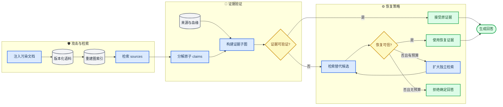
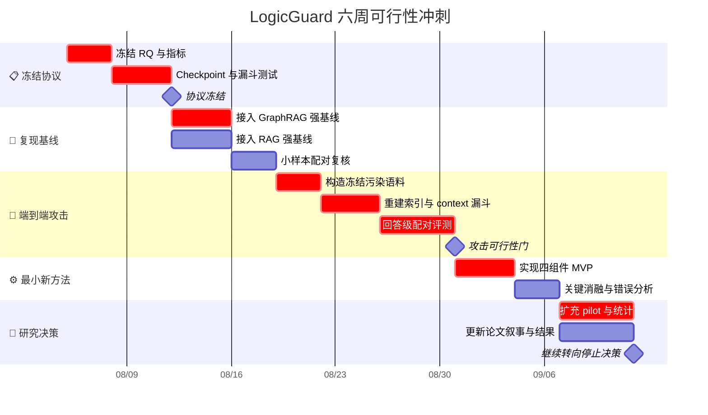

# LogicGuard 硕士学位论文研究计划

_面向 GraphRAG 自适应逻辑投毒的可验证证据恢复研究；版本 1.0，2026-08-04_

---

## 🪪 Material passport

| 字段 | 内容 |
| --- | --- |
| **Origin skill** | `academic-research-suite / experiment-agent` |
| **Origin mode** | `plan` |
| **Origin date** | `2026-08-04` |
| **Verification status** | `UNVERIFIED`，本文件中的阈值是预注册目标，不是已取得结果 |
| **Version label** | `thesis_plan_v1` |
| **项目状态** | Stage47 已完成；端到端语料注入、重建索引与强基线比较尚未完成 |
| **维护方式** | 本文件只维护研究目标、问题、门槛和路线；方法、结果与命令分别进入现有三份主文档 |

### 当前结论

LogicGuard **值得继续推进，但应采用有条件继续策略**：停止继续堆叠 Stage48、Stage49 式局部规则，把接下来六周用于验证论文能否成立。六周结束时只允许三种决定：继续防御论文、转为攻击/评测论文、停止该方向。

当前工程规模和实验积累已经足以支撑硕士论文的工作量，但还不能支撑强研究结论。缺少的不是更多零散实验，而是以下闭环：

1. 从完整污染语料开始重建索引，证明攻击在真实 GraphRAG 流程中能够进入检索与实际 Prompt
2. 与至少一个 GraphRAG 专用防御和一个通用 RAG 投毒防御进行公平比较
3. 把“恢复了候选”拆成正确恢复、错误恢复和未恢复，证明防御没有把一种错误换成另一种错误
4. 用消融、置信区间和跨数据集实验说明增益来自可解释的方法组件，而不是样本、Prompt 或拒答率波动

### 计划使用边界

本文档是后续工作的最高优先级约束。若新实验不能回答本文档中的研究问题、验证某条假设或通过某个决策门，则默认不执行。任何研究目标、主指标、攻击有效性定义或门槛的修改，都必须先在本文档记录原因和版本。

## 🎯 最终研究目标

### 论文题目

中文暂定题目：**面向 GraphRAG 自适应逻辑投毒的可验证证据恢复方法研究**

英文暂定题目：**LogicGuard: Verifiable Evidence Recovery against Adaptive Logical Poisoning in GraphRAG**

### 最终目标陈述

本研究的最终目标是：

> 在攻击者了解检测与恢复规则、能够向知识库注入少量逻辑连贯的污染文档，而防御者无法访问污染标签、标准答案、support doc ID 或精确干净文档映射的条件下，设计并验证一种结合 claim-level 一致性、来源可信性和多跳证据完整性的可验证证据恢复方法，降低 GraphRAG 的定向攻击成功率，同时控制错误恢复、拒答和正常问答效用损失。

这里的研究对象不是“检测一段文本是否像攻击文本”，而是回答两个更实质的问题：当前证据链是否足以支持回答，以及替换进来的证据是否真的比被删除的证据更可信。

### 中心论点

> **Coherence is not integrity：推理链连贯，不等于证据链可信。**

GraphRAG 通过图结构组织实体、关系和多跳路径，但图结构也会放大被注入关系的传播影响。已有工作已经覆盖传统 RAG 知识污染、GraphRAG 关系投毒和逻辑投毒，说明该方向并非研究空白；真正仍有空间的问题，是在自适应、表面连贯的攻击下，如何验证恢复后的证据，而不是只检测明显冲突。[^1][^2][^3][^4]

### 真实落地场景

首要场景是企业、科研机构或政务部门的私有 GraphRAG 知识库：语料来自内部制度、技术文档、审计记录、知识条目和周期性更新。攻击者可能通过被接管的数据源、低权限内容提交、供应链同步或恶意文档更新，植入能够改变多跳关系的内容。

防御可使用的可信根包括：已签名或已审批的历史版本、来源身份、文档血缘、独立来源交叉印证和时间版本关系。研究不声称在“所有来源均被攻破且不存在任何可信根”的条件下恢复客观真相；这种条件下，单靠检索后算法无法给出可验证保证。

### 论文完成定义

论文只有同时满足以下条件，才视为研究闭环完成：

- 在至少两个多跳数据集上完成完整语料注入、重建索引、检索、Prompt 构造和回答评测
- 实现至少三类自适应攻击，并分别报告生成、入索引、检索、Prompt 暴露和回答成功的分母
- 与至少一个 GraphRAG 专用防御、一个通用 RAG 投毒防御和无防御基线比较
- 在推理阶段不读取污染标签、标准答案、support doc ID 或精确 clean doc ID
- 同时报告定向 ASR、正常效用、错误恢复、拒答、延迟和模型调用成本
- 完成关键组件消融、配对统计检验、95% 置信区间和失败案例分析
- 代码、配置、随机种子、语料哈希、索引哈希和结果文件可以复现主要表格

## 🧭 研究问题与论证主线

### 核心研究问题

**RQ：** 在攻击者了解检测和恢复规则的情况下，能否在不使用污染标签和精确 clean doc ID 的前提下，通过 claim-level 一致性、来源可信性和多跳证据完整性验证，降低 GraphRAG 的 targeted ASR，同时避免过滤或错误恢复造成的回答效用崩溃？

### 子研究问题

| 编号 | 研究问题 | 需要的核心证据 |
| --- | --- | --- |
| **RQ1** | 当前三类攻击能否在完整语料注入和重建索引后仍然进入 GraphRAG 的实际 Prompt？ | 入索引率、检索暴露率、Prompt 暴露率、无防御 ASR |
| **RQ2** | 现有 hop consistency、过滤和候选替换方法会在哪些自适应攻击下失效？ | 分攻击族基线结果、失败案例、检测 PR 曲线 |
| **RQ3** | 可验证证据恢复能否优于最强非 oracle 基线？ | ASR 差值、正确/错误/未恢复、配对置信区间 |
| **RQ4** | 安全增益是否以拒答或正常问题效用下降为代价？ | clean utility、abstention、answerability、成本 |
| **RQ5** | 方法中的图路径信号是否提供了文本 RAG 不具备的增益？ | 路径组件消融、GraphRAG 与 matched text-RAG 对照 |

### 可检验假设

下表中的数值是研究目标阈值，用于防止观察结果后再改变成功标准。

| 假设 | 预期结果 | 主要终点 | 否证或失败条件 |
| --- | --- | --- | --- |
| **H1 攻击现实性** | 至少两类攻击在重建索引后仍可传播到回答 | Prompt 暴露率、无防御 system-level targeted ASR | 三类攻击均几乎无法入索引或 Prompt 暴露率低于 5% |
| **H2 防御有效性** | 新方法优于最强非 oracle 基线 | targeted ASR 的配对差值 | 95% CI 包含明显劣化，或绝对降幅不足 10 个百分点且相对降幅不足 30% |
| **H3 恢复完整性** | 新方法减少攻击者诱导的错误替换 | wrong-recovery rate | 错误恢复未下降，或主要增益来自把错误恢复改成拒答 |
| **H4 效用保持** | 正常问题性能基本保持 | clean utility、abstention | clean utility 下降超过 5 个百分点，或拒答率上升超过 10 个百分点 |
| **H5 图特异性** | 来源和路径组件对结果有独立贡献 | 组件消融、matched RAG 对照 | 移除图路径组件没有可测影响，且文本 RAG 得到相同增益 |

### 论证链条

论文必须按以下逻辑展开，不能从“实现了很多阶段”反推贡献：

1. GraphRAG 的图索引提高多跳证据组织能力，但把拓扑完整性变成新的安全假设
2. 逻辑连贯的污染可以绕过只寻找冲突、断跳或异常表面的防御
3. 仅过滤会破坏可答性，强制 top-1 替换又会产生 wrong recovery
4. 因此防御对象应从“恶意文本”改为“不可验证的回答证据链”
5. 通过可信来源、claim 冲突、多跳完整性和恢复完整性联合验证，决定接受、扩展检索、恢复或拒答
6. 端到端攻击、强基线、消融和统计检验共同证明该方法在安全与效用之间的价值

### 与现有研究的关系

| 研究 | 已覆盖问题 | LogicGuard 必须补出的差异 |
| --- | --- | --- |
| PoisonedRAG[^2] | 通用 RAG 中面向目标答案的知识库注入 | 从单段污染扩展到图路径与恢复完整性 |
| GRAGPoison[^3] | 利用 GraphRAG 共享关系进行可扩展投毒 | 评估自适应关系污染后的证据恢复 |
| LogicPoison[^4] | 保持文本表面合理性的逻辑连接攻击 | 防御而非继续复现攻击；覆盖恢复错误 |
| HoG-GRAG[^5] | 逐跳监测、剪枝和局部修复 | 测试结构一致但事实错误，以及候选碰撞情形 |
| RAGDefender[^6] | 检索后轻量检测与过滤 | 比较图特异信号与纯文本后处理 |
| CEG-RAG[^7] | 检测、定位并替换高风险 chunk | 比较强制替换与带完整性门的可拒绝恢复 |

现有 GraphRAG 评测研究也表明，图结构是否优于普通 RAG 取决于任务和流程条件，因此本论文必须设置 matched text-RAG 对照，不能把所有改进自动归因于图结构。[^8]

## 🛡️ 威胁模型与研究边界

### 攻击者能力

| 维度 | 本论文设定 | 不允许的越界设定 |
| --- | --- | --- |
| **知识** | 知道防御流程、特征和阈值；可观察公开输出 | 读取评测标准答案或防御运行时私有随机数 |
| **操作** | 向语料注入或修改少量文档，构造逻辑桥、候选碰撞和低漂移内容 | 修改模型权重、评测脚本或已签名可信快照 |
| **目标** | 使目标问题输出攻击者指定答案，同时保持文本和路径表面连贯 | 仅造成随机错误却被计为 targeted success |
| **预算** | 预注册文档数、token 数和目标 query 数 | 针对每个失败样本无限追加污染文本 |

### 防御者可用信息

防御在推理阶段可以读取 query、检索结果、来源元数据、图实体关系、版本血缘、候选语料和模型输出；不能读取 changed label、gold answer、support doc ID、精确 clean doc ID 或由这些标签派生的风险信号。

标准答案、support 标注和污染标签只允许在攻击生成结束后的离线评测中使用。所有中间产物必须记录 `oracle_used_for_generation` 与 `oracle_used_for_inference`，两者在主实验中均应为 `false`。

### 研究范围

**纳入范围：**

- corpus-level 文档注入后重建 GraphRAG 索引
- retrieval-level 和 post-retrieval source-level 污染传播
- 多跳 QA 中的定向错误答案、错误恢复和拒答
- 白盒自适应攻击、跨数据集迁移和有限模型迁移
- 私有知识库中存在部分可信来源、版本或血缘信息的部署

**不纳入范围：**

- 模型权重后门、训练数据投毒和系统 Prompt 泄露
- 工具调用、代码执行或传统 Prompt injection 安全
- 所有可信根同时失效时的客观真相恢复
- 对开放互联网全部事实进行实时真实性判定
- 以单个数据集、单个 Prompt 或单次随机输出宣称普适鲁棒性

### 攻击与评测分层

实验必须保留完整漏斗，不得把不同层的“有效”混为一谈：

1. `attempted`：发起攻击生成的总次数
2. `generation_valid`：生成内容满足预算、格式和非 oracle 约束
3. `evaluation_valid`：离线标注确认攻击确实表达目标错误关系
4. `index_included`：污染内容进入重建后的实体、关系或社区索引
5. `retrieval_exposed`：目标 query 的检索结果包含污染来源或派生图元素
6. `prompt_exposed`：经过排序、过滤和 token 截断后的实际 Prompt 仍包含污染证据
7. `targeted_success`：最终答案匹配预注册的攻击目标，而非任意错误

主指标 `system-level targeted ASR` 的分母是 `evaluation_valid && index_included` 的攻击；检索失败计为攻击失败。`conditional targeted ASR` 的分母是 `prompt_exposed` 的攻击，只用于解释生成器在暴露后的脆弱性，不能代替主指标。

## ⚙️ 拟议方法与创新点

### 方法定位

LogicGuard 不再被定义为一个不断增加规则的 detector，而被定义为一个 **evidence recovery policy**。它接收检索到的 sources 和图路径，输出以下四种动作之一：

- `accept`：证据链满足可信来源、claim 一致性和路径完整性要求
- `recover`：发现高风险证据，并找到通过完整性验证的替代证据
- `expand`：当前候选不足，限制预算地扩大检索或寻找独立来源
- `abstain`：无法在预算内得到可验证证据，明确拒绝给出确定答案

### 目标架构

### 最小可行方法

第一版新方法只实现四个可独立消融的组件，避免再形成难以解释的规则堆叠：

1. **Claim decomposition**：把 source 中与 query 相关的关系拆成原子主张，区分事实冲突、缺失桥接和不相关补充
2. **Source provenance**：综合来源身份、版本血缘、独立来源数量和与攻击候选的派生关系，避免把攻击者生成的“替代文档”当成独立证据
3. **Path completeness**：检查回答所需多跳链是否覆盖关键桥接实体，并区分“链条完整”与“链条事实可信”
4. **Recovery integrity gate**：候选必须同时满足 query relevance、claim compatibility、独立来源和链完整性；否则选择扩大检索或拒答，而不是强制 top-1 替换

候选排序可以从下式开始，但所有权重必须只在开发集冻结：

`score(c) = wq × queryRelevance + wp × pathCompleteness + ws × sourceTrust + wc × claimCompatibility - wa × attackCorrelation`

硬约束优先于分数：若候选与被判风险 source 具有相同攻击派生链、关键 claim 与可信证据冲突，或只能依赖单一未验证来源，则不得进入 `recover`。

### 拟创新点

论文暂定三项贡献，最终表述必须由实验结果决定：

1. **自适应端到端评测框架**：从完整污染语料到重建索引、检索、Prompt 和回答，统一三类攻击及完整分母
2. **可验证证据恢复方法**：从“检测后删除/强制替换”转为基于 claim、来源和多跳完整性的接受、恢复、扩检索或拒答决策
3. **恢复完整性评测协议**：把 recovery correctness、wrong recovery、no recovery 与最终 ASR 分离，揭示表面安全但实际恢复错误的失败模式

不把以下内容单独宣称为创新：使用 BM25、增加一个阈值、调整 top-k、改 Prompt、增加单一数据集，或把 oracle clean doc 替换包装成真实部署能力。

## 🧪 实验设计

### 已有证据与当前缺口

| 阶段 | 已有证据 | 可以支持的结论 | 不能支持的结论 |
| --- | --- | --- | --- |
| **Stage21** | top-10 poisoned recall `0.805`；只过滤后 recall `0.025` 且 72% 空上下文 | 仅过滤会造成严重效用损失 | 真实非 oracle 恢复已解决 |
| **Stage24** | oracle doc-ID recovery recall `0.785`、changed exposure `0` | 干净对应源存在时恢复具有上界价值 | 不依赖 clean ID 的真实部署有效 |
| **Stage43–45** | 已有 HotpotQA、MuSiQue 的风险恢复与扩展链路 | 具备跨数据集实验基础 | 面对自适应攻击仍然鲁棒 |
| **Stage47** | 75 次尝试、35 次生成有效、21 次评测有效、19 次 Prompt 暴露 | 三类 post-retrieval 自适应失败模式存在 | 完整 corpus poisoning 与重建索引鲁棒性 |

现有详细证据见 [results.md](results.md)，方法演进见 [methodology.md](methodology.md)，复现入口见 [reproducibility.md](reproducibility.md)。Stage47 中最重要的三个信号是：`low_drift` 暴露检测盲区，`candidate_collision` 将 ASR 降到零却产生 5/5 攻击者诱导的非 gold 恢复，`natural_bridge` 在 MuSiQue 上最能体现结构连贯攻击的风险。

### 实验组

| 实验组 | 回答的问题 | 主要产物 | 完成门槛 |
| --- | --- | --- | --- |
| **E0 复核** | 当前 Stage47 统计和字段是否可复现？ | 冻结样本、漏斗单元测试、结果重算 | 同一输入得到相同汇总 |
| **E1 端到端攻击** | 三类攻击能否在重建索引后传播？ | 污染语料、索引哈希、暴露漏斗 | 至少两个数据集完成 context-only 流程 |
| **E2 强基线** | 当前方法相对已发表防御处于何种水平？ | 配对基线结果 | 至少一个 GraphRAG 和一个 RAG 防御 |
| **E3 新方法与消融** | 哪个组件真正降低 ASR 和 wrong recovery？ | 完整方法、六组消融 | 主效应与关键组件效应可解释 |
| **E4 泛化与鲁棒性** | 是否跨数据集、模型和预算稳定？ | 分层结果、迁移结果 | 至少两数据集、两回答模型 |
| **E5 统计与成本** | 改进是否可靠且可部署？ | CI、检验、延迟和成本表 | 主指标有 CI，记录总调用成本 |

### 数据集与实验规模

| 层级 | 数据集 | 最小规模 | 用途 |
| --- | --- | ---: | --- |
| **干运行** | MuSiQue、HotpotQA | 每攻击族每数据集 10 个有效样本 | 校验重建索引和漏斗代码 |
| **六周可行性** | MuSiQue、HotpotQA | 每数据集 50 个评测有效且入索引攻击 | 决定继续、转向或停止 |
| **论文最低规模** | MuSiQue、HotpotQA | 每数据集至少 100 个攻击样本与 100 个配对 clean query | 主结果、消融和统计检验 |
| **扩展验证** | 2WikiMultihopQA | 至少 100 个配对样本 | 检查跨数据集外推 |

论文阶段根据六周 pilot 的方差进行正式 power analysis；在此之前不声称样本量具有预定统计功效。随机生成环节至少使用三个种子，确定性索引和规则输出必须做到同一配置精确复现。

### 系统与模型设置

- **主后端**：项目当前 official Microsoft GraphRAG 流程
- **对照后端**：使用相同 chunk、embedding、top-k 和回答模型的 matched text-RAG
- **可选扩展**：若六周门槛通过，再增加另一种 GraphRAG 实现，不作为短期阻断项
- **回答模型**：一个主模型和一个复现实验模型；冻结完整版本 ID、温度与 Prompt hash
- **裁判模型**：与回答模型分离；抽样进行人工复核，报告裁判一致率

### 攻击族

| 攻击族 | 攻击对象 | Stage47 观察 | 端到端需要验证的内容 |
| --- | --- | --- | --- |
| **Natural bridge** | 无可信 counterpart 的新桥接关系 | MuSiQue 上检测最弱 | 新桥是否入图、被检索并改变多跳路径 |
| **Candidate collision** | 恢复候选排序与替换完整性 | 可降 ASR 但诱导 wrong recovery | 攻击候选能否进入候选池并通过恢复门 |
| **Low drift** | 低实体漂移和表面一致内容 | 风险分数可能为零 | 低漂移内容是否在重建索引后仍保持隐蔽 |

每类攻击冻结文档预算 `b ∈ {1, 3, 5}`、token 预算、目标 query、目标答案和生成 seed。攻击生成失败不得通过反复试验直到命中后只报告成功样本；所有尝试必须进入漏斗。

### 比较基线

| 编号 | 方法 | 角色 | 优先级 |
| --- | --- | --- | --- |
| **B0** | 无防御 GraphRAG | 攻击强度与效用基准 | 必做 |
| **B1** | 当前 Stage43 风险恢复 | 项目现有最小非 oracle 基线 | 必做 |
| **B2** | Stage43 + Stage44/45 | 检查 source enrichment 和 top-k 的贡献 | 必做，作为内部消融 |
| **B3** | HoG-GRAG | GraphRAG 专用逐跳防御 | 必做 |
| **B4** | CEG-RAG 或 RAGDefender | 通用 RAG 检索后投毒防御 | 至少完成一个 |
| **B5** | 新 LogicGuard | 拟议完整方法 | 必做 |
| **B6** | oracle clean recovery | 上界，不参加现实方法排名 | 必做 |

若外部基线无法在两周内以官方代码和冻结配置复现，应记录阻断原因并选择同类可复现基线，不能自行写一个弱化版本后仍使用原论文方法名。

### 主指标

| 类别 | 指标 | 计算或解释 |
| --- | --- | --- |
| **攻击** | `systemTargetedAsr` | `targeted_success / evaluation_valid_indexed` |
| **暴露** | `retrievalExposure`、`promptExposure` | 分别在检索结果和实际截断 Prompt 上测量 |
| **检测** | precision、recall、AUPRC | 以 source/claim 风险标注为单位 |
| **恢复** | correct、wrong、none | 三者互斥；另报 `wrongRecoveryRate` |
| **效用** | clean EM/F1、answerability、abstention | 与配对 clean GraphRAG 比较 |
| **效率** | 延迟、tokens、模型调用数、费用 | context-only 与 answer-level 分开记录 |

`recovered=true` 不等于恢复正确。正确恢复要求新证据支持标准推理链或经离线标注确认的语义等价链；错误恢复包括支持攻击目标、与问题无关、关键跳缺失或与可信来源冲突的候选。

### 变量与混杂控制

| 类型 | 内容 | 控制方式 |
| --- | --- | --- |
| **自变量** | 防御方法、攻击族、预算、数据集、后端、回答模型 | 预注册组合并使用配对 query |
| **因变量** | ASR、暴露、恢复三分类、clean utility、成本 | 使用统一评测器和冻结字段定义 |
| **固定变量** | corpus split、chunk、embedding、top-k、Prompt、温度 | 配置 hash 与运行 manifest |
| **混杂因素** | 索引随机性、Prompt 截断、API 模型漂移、裁判偏差 | 种子、Prompt hash、模型版本、人工抽检 |

### 统计分析

1. 以同一 query、攻击实例和随机种子作为配对单位
2. 对 ASR、clean accuracy、wrong recovery 和暴露率报告分层比例与 bootstrap 95% CI
3. 对配对二元结果使用 McNemar 检验，并同时报告绝对差值和相对差值
4. 多攻击族、多数据集比较使用 Holm 校正，不只报告 `p < 0.05`
5. 结果按数据集和攻击族分别报告，再给宏平均；不得用聚合结果掩盖单一数据集失败
6. 对裁判结果抽取至少 10% 样本进行人工复核，并报告一致性与争议案例

### 关键消融

- 移除 source provenance
- 移除 claim conflict/compatibility
- 移除 path completeness
- 移除 recovery integrity gate
- 用强制 top-1 recovery 替代 `recover/expand/abstain`
- 只过滤、不恢复
- 将 GraphRAG 路径特征替换为 matched text-RAG 特征

## 📅 短期六周计划

短期冲刺从 2026-08-05 到 2026-09-15。前四周只解决攻击现实性和公平基线，第五周才实现最小新方法，第六周作研究方向决策。

### 第 1 周：冻结研究协议与实验基础

时间：2026-08-05 至 2026-08-11。

**任务：**

1. 将本文件中的 RQ、攻击漏斗、主指标和决策门同步到 [methodology.md](methodology.md)
2. 为所有 Stage48 运行增加 checkpoint/resume，防止长任务中断后从头调用 API
3. 定义统一 run manifest：experiment ID、commit、dataset、attack、seed、model ID、corpus hash、index hash、Prompt hash、defense config hash
4. 为 `generation_valid`、`evaluation_valid`、`index_included`、`retrieval_exposed` 和 `prompt_exposed` 增加单元测试
5. 冻结 Stage47 成功样本，不重新随机生成后挑选更有利样本

**交付物：** 可恢复运行器、漏斗字段测试、冻结配置、更新后的复现命令。

**验收：** 中断后能够从最后 checkpoint 继续；同一原始记录只能进入一个确定的漏斗状态；主实验推理路径的 oracle 字段均为 `false`。

### 第 2 周：强基线复现与接口统一

时间：2026-08-12 至 2026-08-18。

**任务：**

1. 优先使用官方代码复现 HoG-GRAG 的最小样本结果
2. 在 CEG-RAG 与 RAGDefender 中选择一个两周内可复现的通用基线
3. 将 B0–B6 统一到相同的 retrieved sources、token budget、回答模型和输出 schema
4. 用 10–20 个固定样本检查每个防御是否读取了额外 oracle 信息
5. 冻结 baseline adapter，不为提高结果临时修改攻击或 Prompt

**交付物：** 至少两个外部基线适配器、配对输出 schema、复现日志。

**验收：** 同一实例可一键经过所有可用基线；无法复现的方法有明确的官方版本、报错和替代选择记录。

### 第 3 周：完整语料注入与重建索引

时间：2026-08-19 至 2026-08-25。

**任务：**

1. 为三类攻击生成独立污染 corpus，保留所有尝试而非只保留成功样本
2. 使用未修改的 GraphRAG 配置重建索引，并记录语料与索引 hash
3. 只运行 context-only 漏斗，检查污染内容是否入图、被检索并进入实际截断 Prompt
4. 在 MuSiQue 与 HotpotQA 各获得至少 20 个评测有效且入索引样本作为干运行
5. 此阶段不修改防御算法，避免攻击与防御共同变化造成不可解释结果

**交付物：** 污染 corpus manifest、索引 manifest、context-only 漏斗 CSV/JSONL。

**验收：** 能从单个最终回答追溯到 Prompt source、检索结果、索引实体/关系和原始污染文档。

### 第 4 周：回答级攻击与基线评测

时间：2026-08-26 至 2026-09-01。

**任务：**

1. 冻结第 3 周样本后，再运行 B0–B4 的真实回答调用
2. 同时评测配对 clean query，测量安全与效用差值
3. 将 `targeted_success` 与普通 incorrect 分离
4. 人工复核攻击有效性、Prompt 暴露和裁判争议样本
5. 达到每数据集 50 个有效攻击的可行性目标，或记录无法达到的具体漏斗层

**交付物：** 第一个端到端 paired baseline 表、攻击族失败案例、实际调用成本。

**验收：** 能回答“攻击失败是因为生成无效、没有入索引、没有被检索、被截断、被防御还是模型没有采纳”。

### 第 5 周：实现最小可行新方法

时间：2026-09-02 至 2026-09-08。

**任务：**

1. 实现 claim decomposition、source provenance、path completeness 和 recovery integrity gate
2. 复用第 4 周冻结输入，不重新选择更有利样本
3. 比较 B5 与最强非 oracle 基线
4. 运行四组件移除、强制 top-1、只过滤三类关键消融
5. 专门复核 wrong recovery，而不是只看最终 ASR

**交付物：** LogicGuard MVP、单元测试、pilot 消融表、错误恢复案例集。

**验收：** 每个组件有独立输入、输出和测试；方法在推理阶段不读取 oracle；结果可以解释增益来自哪个组件。

### 第 6 周：扩充、统计与方向决策

时间：2026-09-09 至 2026-09-15。

**任务：**

1. 对最关键设置补齐 pilot 样本和三个随机种子
2. 计算配对效应、bootstrap 95% CI、McNemar 检验和 Holm 校正
3. 汇总 ASR、错误恢复、clean utility、拒答、延迟和费用
4. 将结果合并进 [results.md](results.md)，不再创建每阶段独立 Markdown 报告
5. 按下节决策门作出“继续防御论文、转为 benchmark 论文或停止”决定

**交付物：** 六周决策表、更新后的方法与结果文档、下一阶段预算估算。

**验收：** 决策能够由预注册指标直接推出，不依赖“感觉结果还可以”。

### 现在开始的前三项工作

本文件审定后，执行顺序固定为：

1. 给 Stage48 增加 checkpoint/resume、run manifest 和漏斗测试
2. 冻结三类攻击与完整重建索引配置，只跑 context-only 暴露检查
3. 并行准备 HoG-GRAG 与一个通用 RAG 防御的适配，但在暴露门通过前不批量调用回答模型

## 🚦 决策门与风险控制

### Gate A：攻击现实性门

决策日期：2026-09-01。

满足以下条件则进入方法开发：

- 至少两类攻击在完整重建索引后达到不低于 20% 的 Prompt 暴露率
- 至少两类攻击在无防御条件下达到不低于 10% 的 system-level targeted ASR
- 成功不是由读取 gold、support ID、changed label 或手工挑选样本得到
- 攻击在至少两个数据集中的一个稳定成立，另一个数据集有可解释差异

若攻击可以入索引但几乎不被检索，则研究应转向图索引和检索传播机制；若攻击在三类设置中均无法入索引或暴露，则停止把 Stage47 当作真实 corpus poisoning 证据。

### Gate B：方法价值门

决策日期：2026-09-15。

继续 LogicGuard 防御论文需要同时看到以下方向性证据：

- 相比最强非 oracle 基线，targeted ASR 绝对下降至少 10 个百分点或相对下降至少 30%
- wrong-recovery rate 至少下降 50%，且不是全部转为拒答
- clean utility 下降不超过 5 个百分点，拒答率增加不超过 10 个百分点
- 至少一个图特异组件在消融后造成可测退化
- 结果在两个数据集或两个回答模型中至少有一种跨设置复现

六周 pilot 的 CI 可能较宽，因此 Gate B 可以允许“方向明确但需扩样本”，但不能允许主结果仅来自 3–5 个样本或一次随机输出。

### 三种最终决定

| 决定 | 触发条件 | 后续动作 |
| --- | --- | --- |
| **继续防御论文** | 攻击端到端成立，新方法优于强基线且效用可控 | 扩大样本、完成消融与论文写作 |
| **转为 benchmark 论文** | 攻击稳定且揭示现有防御缺口，但新方法没有稳定优势 | 聚焦自适应攻击、评测协议和失败分类 |
| **停止该方向** | 攻击重建索引后基本消失，或增益依赖 oracle/拒答，且无图特异发现 | 保留工程资产，选择新的硕士课题 |

### 主要风险

| 风险 | 后果 | 控制措施 | 触发后的调整 |
| --- | --- | --- | --- |
| **2026 相关工作挤压创新** | 方法与 HoG-GRAG、CEG-RAG 重复 | 用自适应 coherent attack 和 wrong recovery 明确差异 | 转向恢复完整性或 benchmark 贡献 |
| **攻击生成有效率低** | 成本高、统计功效不足 | 先 context-only、保存全部尝试、分析失败层 | 缩小攻击族但扩大有效样本 |
| **API 成本失控** | 无法完成大样本 | checkpoint、缓存、Prompt 暴露门、冻结输入 | 优先回答主设置，次要设置用 proxy |
| **oracle 泄漏** | 结论不真实 | 双 oracle 字段、代码审计、测试 | 泄漏运行全部作废重跑 |
| **裁判模型偏差** | ASR 与正确率失真 | 独立裁判、人工抽检、规则与模型双评测 | 报告争议集并做敏感性分析 |
| **增益来自拒答** | 安全但不可用 | 联合报告 ASR、utility、abstention | 调整扩检索预算而非继续过滤 |
| **代码与报告继续膨胀** | 难以维护和写论文 | E0–E5 命名、三份主报告、raw artifact 分离 | 禁止新增逐阶段报告文件 |

## 📝 论文结构与项目规范

### 学位论文章节

| 章节 | 核心内容 | 对应研究证据 |
| --- | --- | --- |
| **第 1 章 绪论** | GraphRAG 投毒问题、真实场景、研究问题与贡献 | RQ、威胁模型、部署假设 |
| **第 2 章 相关研究** | GraphRAG、RAG 投毒、逻辑投毒、检测与恢复 | 系统文献矩阵与差异定位 |
| **第 3 章 威胁与评测框架** | 三类攻击、端到端漏斗、指标和数据集 | E0、E1、攻击现实性门 |
| **第 4 章 LogicGuard 方法** | claim、来源、路径和恢复完整性 | 方法公式、算法、复杂度 |
| **第 5 章 实验与分析** | 基线、主结果、消融、统计、失败案例 | E2–E5 全部证据 |
| **第 6 章 落地与讨论** | 私有知识库部署、可信根、成本、限制 | 效率、案例、边界条件 |
| **第 7 章 总结** | 回答 RQ、贡献边界与未来工作 | 决策门与结论 |

### 统一文档结构

为满足项目简洁化要求，后续不再为每个 Stage 创建多份 Markdown 报告。只维护以下研究文档：

| 文件 | 唯一职责 | 更新时机 |
| --- | --- | --- |
| `docs/thesisPlan.md` | 目标、RQ、假设、门槛和路线 | 研究决策变化时 |
| `docs/methodology.md` | 方法、攻击、实验协议和实现边界 | 方法或协议冻结时 |
| `docs/results.md` | 所有阶段结果、统计与失败案例 | 每个实验组完成时 |
| `docs/reproducibility.md` | 环境、命令、配置和 artifact 索引 | 新增可复现实验时 |

`handoff.md` 只用于会话交接，不作为论文证据主文档。原始逐样本结果进入 `outputs/` 下的 CSV/JSONL，图表进入统一 figures 目录；实验结论只能追加到 `results.md`，不得从临时日志直接写入论文。

### 命名与实验编号

- 论文实验使用 `E0`–`E5`，不再用无限递增 Stage 表达研究贡献
- 人类阅读文档使用简短 `camelCase`，例如 `thesisPlan.md`
- Python 模块遵循 PEP 8 的 `snake_case`，避免为追求文件驼峰破坏 import 生态
- 类名使用 `PascalCase`，函数和变量使用 `snake_case`
- raw run ID 使用可排序的 `e1_dataset_attack_seed_timestamp`
- 每个汇总行必须能回溯到 run manifest、配置 hash 和原始记录

### 复现与数据治理

每次主实验至少保存以下字段：

- Git commit、Python 版本、依赖锁文件 hash 和操作系统
- 数据集版本、split、query ID、原始 corpus hash 和污染 corpus hash
- GraphRAG 配置、索引 hash、检索模式和 token 截断参数
- 攻击族、预算、target、seed、生成模型和生成 Prompt hash
- 防御版本、阈值、候选池、回答模型和回答 Prompt hash
- 各漏斗布尔值、最终答案、裁判结果、人工复核状态和费用

任何昂贵实验在运行前必须先通过：小样本 dry-run、输出路径检查、checkpoint 检查、oracle 泄漏检查和预计费用检查。

### 中期路线

若 2026-09-15 决定继续，后续按下列里程碑推进：

| 时间 | 目标 | 完成标志 |
| --- | --- | --- |
| **2026-09 至 2026-10** | 扩展主实验规模和跨模型验证 | 两数据集主表、强基线与 CI 完成 |
| **2026-10 至 2026-11** | 完成消融、迁移、效率和人工复核 | 所有 RQ 有直接证据 |
| **2026-11 至 2026-12** | 冻结方法与实验，撰写论文初稿 | 第 1–5 章完整草稿 |
| **2027-01 起** | 补审稿式实验、润色和答辩材料 | 可复现包、终稿和答辩 PPT |

## 🔗 参考文献

[^1]: Edge, D., Trinh, H., Cheng, N., et al. (2024). “From Local to Global: A Graph RAG Approach to Query-Focused Summarization.” _arXiv:2404.16130_. https://arxiv.org/abs/2404.16130

[^2]: Zou, W., Geng, R., Wang, B., & Jia, J. (2025). “PoisonedRAG: Knowledge Corruption Attacks to Retrieval-Augmented Generation of Large Language Models.” _34th USENIX Security Symposium_. https://www.usenix.org/conference/usenixsecurity25/presentation/zou-poisonedrag

[^3]: Liang, J., Wang, Y., Li, C., et al. (2025). “GraphRAG under Fire.” _arXiv:2501.14050_. https://arxiv.org/abs/2501.14050

[^4]: Xiao, Y., Chen, J., Zhang, Q., et al. (2026). “LogicPoison: Logical Attacks on Graph Retrieval-Augmented Generation.” _Proceedings of ACL 2026, Long Papers_. https://aclanthology.org/2026.acl-long.252/

[^5]: Noughabi, H. A., Zarrinkalam, F., & Dehghantanha, A. (2026). “Defense Against Knowledge Poisoning Attack on GraphRAG.” _Proceedings of ACL 2026, Short Papers_. https://aclanthology.org/2026.acl-short.47/

[^6]: Kim, M., Lee, H., & Koo, H. (2025). “Rescuing the Unpoisoned: Efficient Defense against Knowledge Corruption Attacks on RAG Systems.” _arXiv:2511.01268_. https://arxiv.org/abs/2511.01268

[^7]: Moradi, R., Noughabi, H. A., Zarrinkalam, F., & Dehghantanha, A. (2026). “Defending RAG Against Knowledge Poisoning Using Cross-Encoder Activation Signals.” _Proceedings of Machine Learning Research, 318_. https://proceedings.mlr.press/v318/moradi26a.html

[^8]: Xiang, Z., Wu, C., Zhang, Q., et al. (2025). “When to use Graphs in RAG: A Comprehensive Analysis for Graph Retrieval-Augmented Generation.” _arXiv:2506.05690_. https://arxiv.org/abs/2506.05690

---

_最后更新：2026-08-04；下一次强制审查：2026-09-01（攻击现实性门）_
