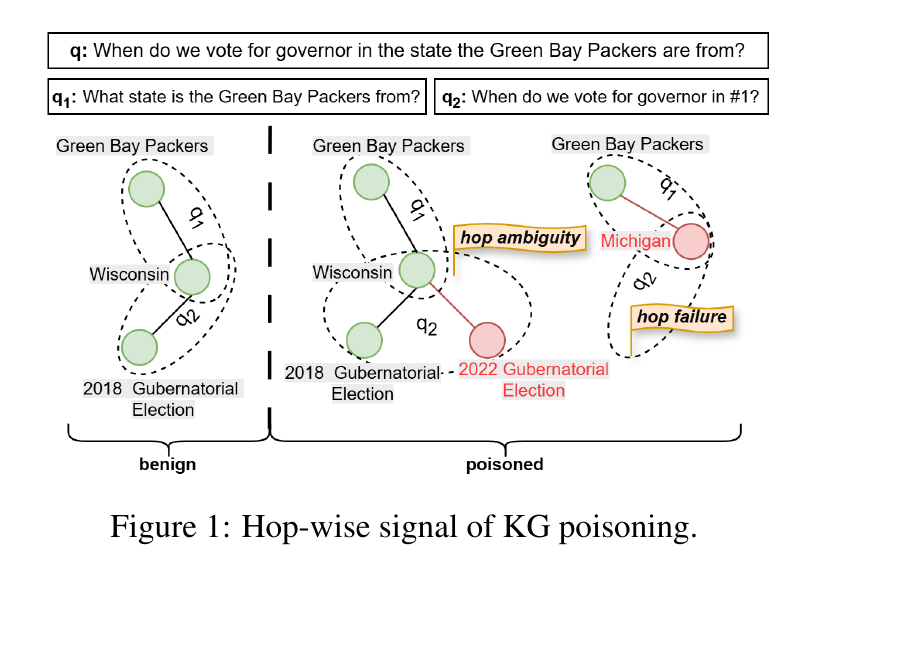
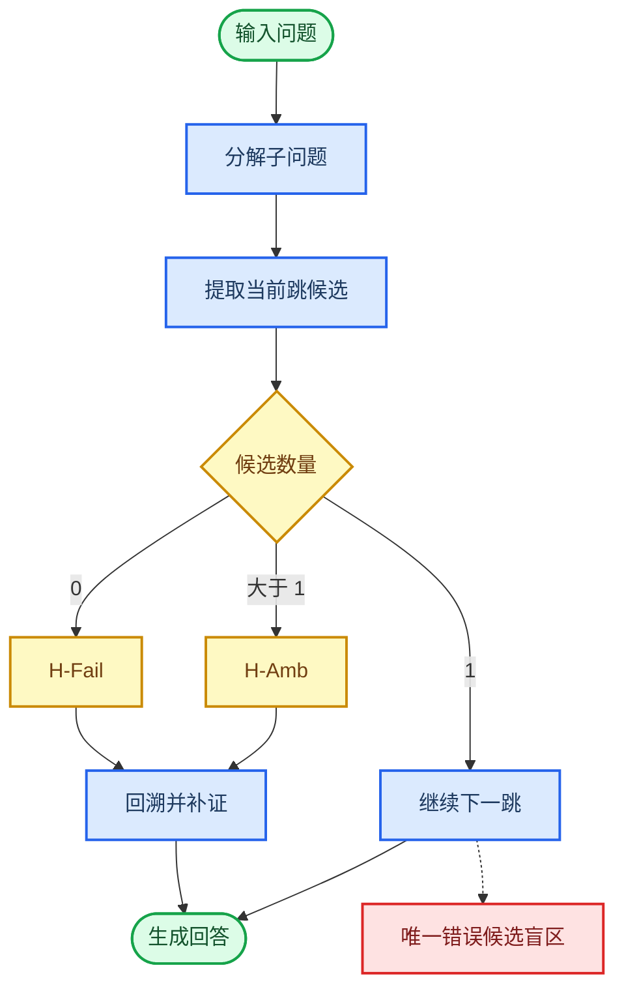
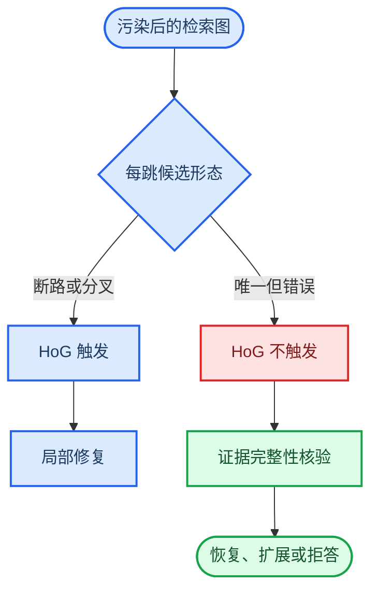

# P41 HoG-GRAG 论文简报

> 2026-10-10 整理副本：论文链接改为本库同题 PDF，配图随库保存；正文未重新核验，代码与结果链接仍指向原仓库。

_LogicGuard 相关工作解读 · 2026-08-08 · 基于 P41、LogicPoison 原文与当前项目实现_

---

## 📍 论文基本信息

| 项目 | 信息 |
| --- | --- |
| **英文标题** | _Defense Against Knowledge Poisoning Attack on GraphRAG_ |
| **中文译名** | 《面向 GraphRAG 知识投毒攻击的防御》 |
| **方法名称** | Hop-wise Guard for GraphRAG（HoG-GRAG，GraphRAG 逐跳防护） |
| **作者** | Havva Alizadeh Noughabi1、Fattane Zarrinkalam1,2、Ali Dehghantanha1 |
| **作者单位** | 1 加拿大圭尔夫大学计算机科学学院 Cyber Science Lab；2 加拿大圭尔夫大学工程学院 |
| **出版年份** | 2026 年 |
| **会议日期** | 2026 年 7 月 2—7 日 |
| **会议名称** | 第 64 届计算语言学协会年会（The 64th Annual Meeting of the Association for Computational Linguistics，ACL 2026） |
| **发表载体** | _Proceedings of the 64th Annual Meeting of the Association for Computational Linguistics (Volume 2: Short Papers)_ |
| **论文类型** | ACL 2026 短论文；**会议** |
| **页码** | 555—563 |
| **出版机构** | Association for Computational Linguistics |
| **官方页面** | [ACL Anthology: 2026.acl-short.47](https://aclanthology.org/2026.acl-short.47/)[^1] |
| **本库可读 PDF** | [HoG-GRAG_ACL2026.pdf](../01_GraphRAG与知识图谱攻击防御/02_HoG-GRAG_ACL2026.pdf)；历史 P41 文件尚未同步，版本是否相同未比对 |

## 📋 结论

P41 提出的 **HoG-GRAG** 是一种面向 GraphRAG 的查询时防御：它把多跳问题拆成若干子问题，逐跳检查候选实体数量；一旦某一跳没有候选（H-Fail）或出现多个候选（H-Amb），就回溯、扩大到完整知识图谱并重建局部证据链。论文在 Microsoft GraphRAG 与 LightRAG、HotpotQA 与 MuSiQue 上报告了 `70.67%–82.67%` 的攻击检测率和较低的良性误报率。[^1]

| 问题 | 简要判断 |
| --- | --- |
| **P41 的核心贡献是什么？** | 用“每一跳是否唯一可执行”做结构异常检测，并在检测后进行局部图修复 |
| **能否防御 LogicPoison？** | **只能防御一部分**。若 LogicPoison 造成断路或分叉，HoG-GRAG 有机会检出；若生成唯一、类型一致但语义错误的路径，则可能完全绕过 |
| **与 LogicGuard 是否重复？** | 有交集但不等价。P41 检查路径可执行性；LogicGuard 应进一步检查证据来源与语义完整性 |
| **对项目意味着什么？** | HoG-GRAG 应成为强制基线和结构信号模块；LogicGuard 的创新重点应转向“连贯但不可信”的证据链 |

> **核心判断：** P41 证明了 GraphRAG 中“逐跳检测与修复”是有效研究方向，但它没有解决 LogicPoison 最危险的情形——**错误路径仍然唯一、连贯、类型正确**。

## 📄 P41 核心设计

### 威胁模型与输入

系统接收问题 $q$、初始检索子图 $G_q$ 和完整知识图谱 $G$。问题被分解为 $H$ 个子问题：

$$
q \rightarrow \{q_1,q_2,\ldots,q_H\}.
$$

论文的重要假设是：攻击者可以注入恶意边，但不会删除原有良性边，因此正确推理路径仍可能保存在完整图 $G$ 中。该假设直接决定了“回到完整图补证”为何可能成功。[^1]

  

_图 1：P41 原文 Figure 1。图片已按页面宽度自适应显示；单击可查看完整原图。正常路径每跳有唯一候选，污染可能制造 H-Amb 或 H-Fail。[^1]_

### 逐跳异常检测

设第 $i$ 跳的候选实体集合为 $C_i$。HoG-GRAG 的判定可以概括为：

$$
D_i=
\begin{cases}
1, & |C_i|=0 \quad \text{H-Fail},\\
1, & |C_i|>1 \quad \text{H-Amb},\\
0, & |C_i|=1 \quad \text{认为安全}.
\end{cases}
$$

查询级检测结果为：

$$
D(q)=\max_{1\le i\le H}D_i.
$$

_图 2：HoG-GRAG 的检测与修复流程；虚线分支是其关键盲区。_

> **通俗解释：** 它像逐段检查导航路线：下一段没路，说明可能被破坏；突然有多条互相冲突的路，说明可能被插入了假路；只有一条路就继续走。问题在于，攻击者也可以精心铺出一条“唯一但通向错误终点”的路。

### 回溯与局部图修复

检测到异常后，系统在 $G_q$ 中尝试替代候选；候选不足时查询完整图 $G$；若后续跳失败，则退回上一跳并尝试下一个候选。只有被最终采用的证据才进入修复子图：

$$
\widetilde{G}_q=\operatorname{InduceGraph}
\left(G_{\text{work}},\bigcup_{i=1}^{H}E_i\right).
$$

终点仍有多个候选时，论文使用与前序证据实体重合度最高的候选作为启发式决胜：

$$
r_H=\arg\max_{c\in C_H}\left|\Phi(c)\cap E_{\mathrm{pref}}\right|.
$$

其中，$\Phi(c)$ 表示候选 $c$ 的相关实体集合，$E_{\mathrm{pref}}$ 表示前序已接受证据中的实体。

> **通俗解释：** 检测器发现路不通或岔路太多后，会退回上一个路口换一条路；局部地图不够就查全城地图。但如果全城地图也被改过，或者两条路看起来同样合理，它仍可能选错。

## 📊 实验结果与证据强度

P41 在两套 GraphRAG 管线和两个多跳问答数据集上各构造 `300` 条攻击成功样本，并另外评估良性查询。论文使用的是基于关系替换或增强的 GRAGPoison 风格攻击，而不是 LogicPoison。[^1][^3]

| 管线 / 数据集 | 检测 TPR | 检出后修复 AM | 推算的全流程恢复率 |
| --- | ---: | ---: | ---: |
| **Microsoft / MuSiQue** | 82.67% | 72.58% | 60.00% |
| **Microsoft / HotpotQA** | 79.67% | 84.52% | 67.33% |
| **LightRAG / MuSiQue** | 77.33% | 69.83% | 54.00% |
| **LightRAG / HotpotQA** | 70.67% | 61.32% | 43.33% |

> **推算说明：** “全流程恢复率”不是论文直接报告的指标，而是依据表中整数样本反推为“检测数 × 检出后修复率 / 300”。例如 Microsoft/MuSiQue 为 `248 × 72.58% / 300 = 60.00%`。论文没有充分说明修复 AM 的分母，因此该列应标记为复核性推断，而不是正式复现结果。

良性查询的误报率为 `6.33%–9.33%`，回答匹配率为 `97.67%–99.00%`；在论文设置下，防御没有造成显著的良性性能下降。[^1]

### 优点

- 在真实语料注入后重建知识图谱，而非只修改已检索上下文
- 同时覆盖 Microsoft GraphRAG 与 LightRAG
- 明确展示检测失败与修复失败案例
- 将检测、修复和良性效用分开评估

### 局限

- 只验证二跳问题，且依赖正确的问题分解
- 每条查询额外消耗约 `3.12–3.97` 次 GPT-5-mini 调用[^1]
- 没有直接测试 LogicPoison 或知道防御规则的自适应攻击
- 检测信号与所用攻击造成的断路、分叉现象高度匹配
- 未清晰报告完整防御链路上的 targeted ASR 和修复错误率

## 🛡️ 对 LogicPoison 的防御判断

LogicPoison 的关键不是简单加一条冲突边，而是对同类型实体做替换或循环置换，使多跳推理仍然结构完整，却被导向错误实体。设同一类型 $\tau$ 的实体集合为 $E_\tau=\{e_1,\ldots,e_m\}$，其循环置换可写为：[^2]

$$
\pi_\tau(e_i)=
\begin{cases}
e_{i-1}, & 1<i\le m,\\
e_m, & i=1.
\end{cases}
$$

| 比较维度 | P41 所测攻击 | LogicPoison |
| --- | --- | --- |
| **主要操作** | 注入或增强恶意关系 | 类型保持的实体替换与语料重写 |
| **典型图症状** | 断路、额外分支、局部冲突 | 唯一且连贯的错误路径 |
| **良性路径是否保留** | 威胁模型假设保留 | 可能被改写或切断 |
| **HoG 检测机会** | 较高，容易出现 H-Fail/H-Amb | 取决于是否产生结构异常 |
| **完整图补证是否可靠** | 可能找到原良性边 | 完整图本身也可能已污染 |

_图 3：P41 更擅长处理结构异常；LogicPoison 的强攻击形态要求进一步验证证据完整性。_

据此，对 LogicPoison 的分情形判断如下：

- **Global Logic Poison：部分有效。** 大范围实体置换更可能造成断路或分叉，HoG-GRAG 因而可能检出一部分；但若完整图同样被重写，修复不再拥有可信后备证据
- **Query-Centric Logic Poison：预计较弱。** 攻击专门选择多跳桥接实体，可构造类型正确、每跳唯一的错误链，正好落入 P41 附录展示的“唯一错误候选”盲区[^1][^2]
- **良性与恶意证据共存：较有效。** 两条路径同时出现时容易形成 H-Amb，HoG-GRAG 的检测和回溯最有优势

> **严格结论：** 目前只能说 HoG-GRAG **可能缓解部分 LogicPoison 实例**，不能声称它已经防御 LogicPoison；两篇论文之间尚无直接交叉实验。

## 🔍 与 LogicGuard 的关联

### 当前方法的互补与共同盲区

| 能力 | HoG-GRAG | 当前 LogicGuard | 建议的完整 LogicGuard |
| --- | --- | --- | --- |
| **主要信号** | 每跳候选数量 | 标题重合、实体漂移、clean candidate | 结构、语义声明、来源谱系、路径完整性 |
| **回答的问题** | 路径能否唯一执行 | 当前 source 是否偏离可信候选 | 整条证据链是否可信且足以支持答案 |
| **擅长情形** | 断路、分叉 | 有可信 counterpart 的显著漂移 | 连贯污染、冲突候选、无 counterpart |
| **主要盲区** | 唯一错误路径 | 低漂移、自然桥接、错误恢复 | 需要通过实验验证 |
| **异常后动作** | 回溯并强制选路 | 过滤、替换、追加 | 接受、恢复、扩展、拒答 |

当前实现中，[`detect_non_oracle_source_risk`](../../src/logicguard/defense/risk_aware_recovery.py) 主要在标题重合度不低于 `0.80` 且实体漂移不低于 `0.20` 时触发；找不到 clean candidate 时默认不报风险。另一方面，[`_context_chain_metrics`](../../src/logicguard/defense/chain_completion.py) 仍使用 gold `support_doc_ids` 和标准答案做离线诊断，尚不是可直接部署的证据链证明。

[Stage47 自适应攻击结果](../../docs/results.md) 已经出现与 P41 失败案例高度一致的现象：

- **低实体漂移：** 检出率为 `0`，对应“结构和表面语义均看似正常”
- **自然桥接：** MuSiQue 上 Stage43 为 `7/8` targeted success，对应“无可信 counterpart 的唯一错误链”
- **错误候选碰撞：** 攻击 source 被检出，但 `5/5` 恢复到非 gold support，对应“检测正确不等于修复正确”

这说明 P41 不是简单否定 LogicGuard，而是在帮助我们把研究问题进一步收紧：

> **论文主张应从“检测 GraphRAG 污染”升级为“验证并恢复 GraphRAG 的证据完整性”。核心故事是：Coherence is  not integrity——推理链连贯，不等于证据链可信。**

建议把 HoG 的结构信号并入风险函数，但不把它视为最终判定：

$$
R(q)=w_sS_{\mathrm{struct}}+w_cS_{\mathrm{claim}}
+w_pS_{\mathrm{provenance}}+w_hS_{\mathrm{path}}.
$$

其中，$S_{\mathrm{struct}}$ 检查断路或分叉，$S_{\mathrm{claim}}$ 检查声明冲突，$S_{\mathrm{provenance}}$ 检查来源可信度与谱系，$S_{\mathrm{path}}$ 检查回答所需证据是否完整。系统不应在冲突时强制选择第一个候选，而应在以下动作中进行风险决策：

$$
a^*=\arg\min_{a\in\{\text{accept,recover,expand,abstain}\}}
\widehat{L}(a\mid R,C).
$$

> **通俗解释：** HoG 检查“路通不通”；新的 LogicGuard 还要检查“路牌是不是伪造的、地图从哪里来的、这条路是否真的能证明终点”。没有足够可信证据时，拒答比自信地选错更安全。

## 🧪 建议的最小验证实验

下一阶段不宜立刻重写全部防御代码，应先做一个能决定研究路线的对照实验：

1. **复现 P41 设置**：确认检测 TPR、修复 AM 的真实分母及端到端恢复率
2. **替换攻击**：在同一 GraphRAG 管线上加入 Global 与 Query-Centric LogicPoison
3. **记录每跳轨迹**：将样本分为 H-Fail、H-Amb、unique-correct、unique-wrong
4. **比较五组方法**：无防御、HoG-GRAG、当前 LogicGuard、二者混合、oracle 上界
5. **报告完整指标**：targeted ASR、检测 TPR/FPR/AUPRC、正确恢复/错误恢复/无恢复、clean utility 与调用成本

最关键的判定实验是：

$$
\operatorname{ASR}_{\mathrm{unique\text{-}wrong}}(\mathrm{HoG})
\quad \text{vs.} \quad
\operatorname{ASR}_{\mathrm{unique\text{-}wrong}}(\mathrm{LogicGuard\text{-}hybrid}).
$$

如果混合方法能显著降低 `unique-wrong` 子集上的 targeted ASR，同时保持低良性误报，LogicGuard 就形成了区别于 P41 的清晰创新证据；如果不能，项目应暂停扩展，先重新设计可验证的来源与声明一致性机制。

## 🎯 最终结论

- P41 是与 LogicGuard **高度相关且必须纳入比较** 的工作，它占据了“逐跳结构异常检测与局部修复”这一位置
- P41 对其设定下的关系注入攻击有效，但没有直接证明能防御 LogicPoison
- LogicPoison 的唯一连贯错误链会同时挑战 P41 和当前 LogicGuard，不能把这一问题包装成已经解决
- LogicGuard 仍值得继续，但创新点必须落在 **证据完整性验证、恢复完整性评估、自适应攻击与安全拒答**，而不是重复提出 hop-wise repair
- 最优路线是把 HoG-GRAG 作为结构基线或子模块，用 LogicGuard 解决它明确暴露的 `unique-wrong` 与错误恢复问题

## 🔗 参考资料

[^1]: Alizadeh Noughabi, H., Zarrinkalam, F., & Dehghantanha, A. (2026). “Defense Against Knowledge Poisoning Attack on GraphRAG.” _Proceedings of ACL 2026, Short Papers_. https://aclanthology.org/2026.acl-short.47/

[^2]: Xiao, Y., et al. (2026). “LogicPoison: Logical Attacks on Graph Retrieval-Augmented Generation.” _Proceedings of ACL 2026, Long Papers_. https://aclanthology.org/2026.acl-long.252/

[^3]: Liang, et al. (2025). “GraphRAG under Fire: Knowledge Poisoning Attacks and Defenses.” _arXiv preprint_. https://arxiv.org/abs/2501.14050

---

_最后更新：2026-08-08_
